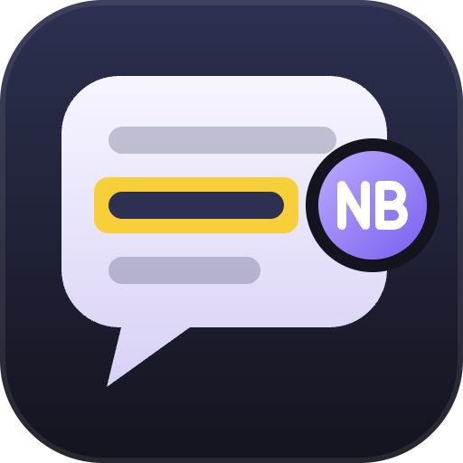

<p align="center"></p>

# Nota Bene

A browser IDE for [Claude Code](https://claude.com/claude-code), built on the Claude Agent SDK. Same agent, same settings, skills and plugins — with a review-first interface:

- **Margin comments.** Select any fragment of a reply or a file, leave a note, send all notes to the agent as one batch.
- **Media instead of ASCII.** Mermaid and SVG diagrams, images, video and audio right in the chat; a built-in viewer for project files.
- **Claude Code parity.** Mid-turn messages, `@` file mentions, image paste, prompt suggestions, permission modes and plan approval, context and plan-limit meters, `/compact`, `/clear`, resuming any Claude Code session.

Status: a working prototype in [`prototype/`](prototype/) (plain Node + one HTML file); a React + TypeScript rebuild is being planned at the root.

## Run the prototype

```sh
cd prototype && npm install
./ide.sh /path/to/your/project        # opens http://127.0.0.1:4777
```

Or from Claude Code: link `prototype/skill` as `~/.claude/skills/nb` and run `/nb` in any project.
