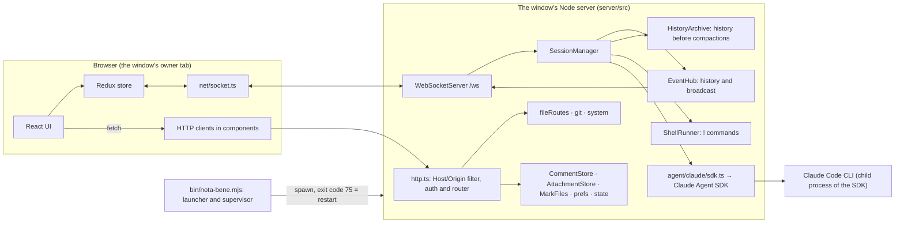
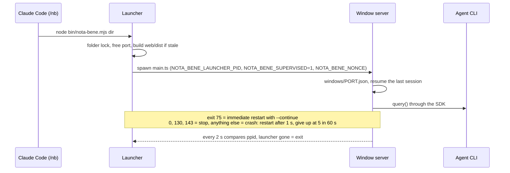
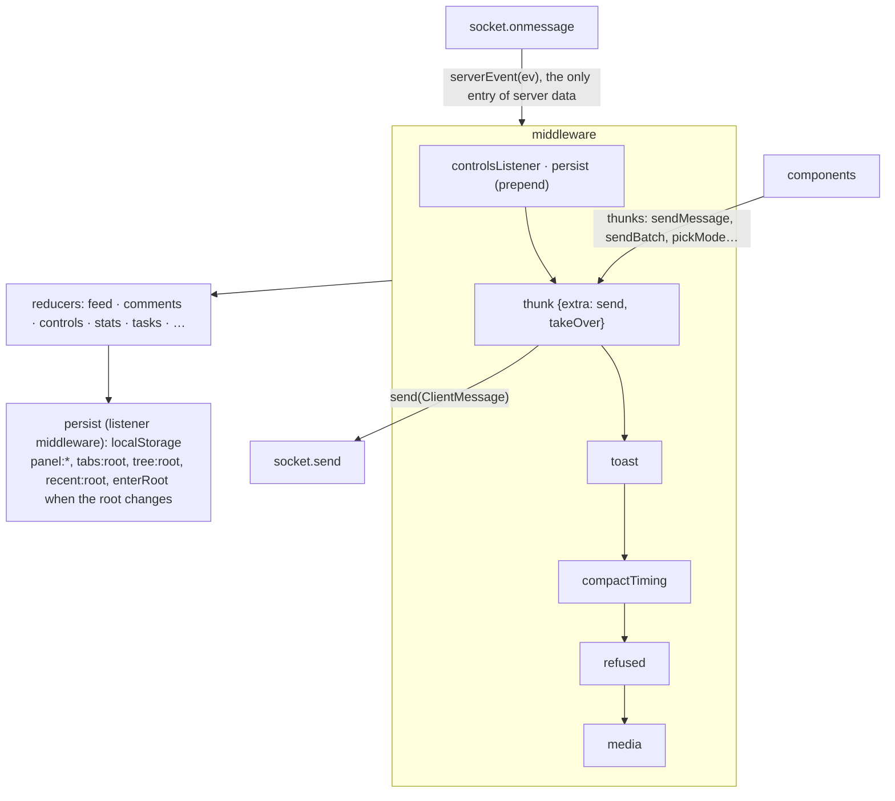
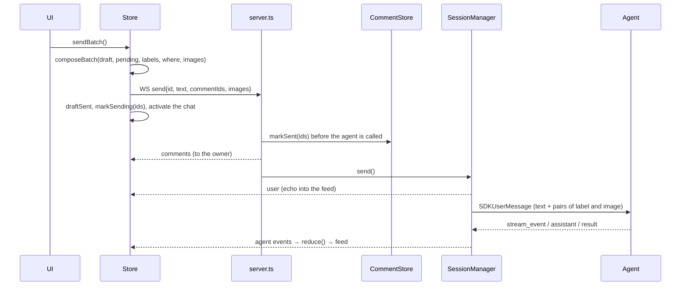

# Nota Bene architecture

State as of 2026-10-31, release 1.1.0 on `main`.

## 1. Overview

Nota Bene is a local web application. One **window** is one server process, one project folder, one port from 4777 to 4799 and one agent session (Claude Code or Codex). The provider is fixed at launch; session discovery and persisted state are scoped to it. One browser tab works with the window (the owner); other tabs see "the window is already open" and can take it over.

The diagram below shows the Claude process path. The same SessionManager also
accepts the Codex backend through `AgentBackend` / `AgentSession`. That adapter owns
a native `codex app-server` JSON-RPC child, normalizes live events and paginated
history, and exposes explicit capabilities. Native SDK/RPC shapes stay in adapters.
Codex state lives under `<base-state>/providers/codex`; Claude keeps the legacy base.
ACP remains a future backend.



**Packages** (npm workspaces):

| Package | Contents |
|---|---|
| `shared/` | One file, `shared/src/protocol.ts`: the protocol types (`ClientMessage`, `ServerEvent`, `AgentEvent`, `Comment`, `Anchor`, `MediaShape`), the validator `parseClientMessage` and the `PROTOCOL` version. The contract shared by web and server. |
| `server/` | In a checkout, Node >= 23.6 runs the `.ts` files directly, with no build. The published package ships the server compiled to plain JS (Node >= 22). Dependencies: `@anthropic-ai/claude-agent-sdk` and `ws`, nothing else (no HTTP framework). |
| `web/` | React 19, Redux Toolkit 2, Radix UI, Tailwind 4, Vite 8. Markdown on `marked` + `dompurify` + `highlight.js` + `mermaid`. Fonts (Inter, Geist Mono) are bundled; the page makes no request to a font service. |
| `bin/nota-bene.mjs` | The launcher: port choice, folder lock, rebuild of a stale `web/dist`, supervision, and the helpers `--find`, `--last`, `--url`, `--front`. |
| `plugin/skills/nb/` | The `/nb` skill for Claude Code (inside the plugin `plugin/`): `open.sh --plan / --wait / --run`. |
| `e2e/` | Playwright on a fake agent (`server/src/agent/fake.ts`, `--fake script.json`). |

## 2. Processes and lifecycle



- **Supervision runs both ways.** The launcher restarts the server. The server exits by itself if the launcher is gone (`watchLauncher`). A foreground launcher in turn stops when the shell that started it is gone (`watchParent`), unless it is a `--detach` child. Launcher environment variables that were not inherited from the direct parent are dropped (`dropInheritedLauncherEnv`), so a test server started from inside a window does not think it is supervised.
- **The launcher's secrets.** The launcher creates a random per-launch nonce and passes it to every server it starts (env `NOTA_BENE_NONCE`). Exit 75 keeps it, so open tabs stay logged in. After a crash it is replaced and the launcher opens a fresh login page. See section 6.
- **The window registry** `~/.nota-bene/windows/<port>.json` serves "one window per folder" and Settings, Windows. A launch takes a per-folder lock (`locks/<hash>`), then gives way to a window already serving the folder, waiting up to 10 s for one that is in its restart gap.
- **Control between windows** (M6-15). Window A sends `POST /system/windows/action`; its server proxies the request to `127.0.0.1:<port B>/control/<action>` with the token from `<stateDir>/control-token` (mode 600). `/control/*` rejects any request that has an `Origin` header, so only a server can reach it, never a page.

### 2.1 Package and the 3D flag

`scripts/build-package.mjs` builds the npm package into `pkg/`. The server and the launcher are bundled by esbuild into JS at the same directory depth as the sources (so the relative `import.meta` paths to `web/dist` and to the blend assets stay correct), `@nota-bene/shared` is inlined, and `web/dist` is built fresh. The installed package has no `web/src` and no `.git`: the launcher never builds, `codeChanged` is always false, and the version comes from `package.json`. The `/nb` skill finds the launcher in a checkout first, otherwise it installs the package `nota-bene-ide@<plugin version>` into the plugin's data folder on the first run. 3D viewing is experimental and off by default (`NOTA_BENE_EXPERIMENTAL_3D=1`): the server announces the flag in `hello.capabilities.model3d`, and before that hello the web treats models as ordinary files.

## 3. Server

### 3.1 Modules

| Module | Responsibility |
|---|---|
| `main.ts` | Argument parsing, choice of what to resume, exit code 98 when the port is taken, the launcher watchdog. |
| `server.ts` | Composition: creates the stores, `SessionManager`, the HTTP router and the WSS. It also holds the dispatcher of WebSocket messages and the link between comments and the session. One tab per window: an owner socket; a reload of the owner within 700 ms (grace) is not a second tab; a ping to the owner every 30 s (no pong means `terminate`); `takeover` (the old owner gets `taken-over` and is closed with code 4001); passive reconnection `?passive=1`. Messages that the agent's `capabilities` forbid are rejected as `server-error`. |
| `auth.ts` | The access token and every value derived from it: cookie, key, login, helper bearer and the `/hello` proof (section 6). |
| `stateGuard.ts` | Knows the folders that hold secrets (the current state folder and the two default ones) and refuses to serve, list or search anything inside them. |
| `http.ts` | No framework. Order: Host allowlist, then `/control/` (token, no Origin) or Origin for non-GET, then the open routes (`/auth`, `/hello`), then the auth check for everything else, then prefix routes (`/attach/`, `/marks/`, `/control/`), exact routes, `/info`, and last the static files of `web/dist` with an SPA fallback. |
| `hub.ts` | `EventHub`: the in-memory event history of the current session. A connecting socket gets `replay` (with `earlier`, the number of archived segments), then live events. `reset()` replaces the history (switch, `/clear`, restart). `cut()` moves everything before a compaction boundary into the archive; some events (sends not yet finished) stay in both the history and the archive. |
| `archive.ts` | `HistoryArchive`: `history/<sid>.jsonl`, one line per segment (the conversation before a compaction), fsync on write, a broken line is skipped. The route `/history?session=&before=`. |
| `subagent.ts` | The route `GET /subagent?session=&tool=` (protocol 7): the conversation of the subagent started by the Agent call with tool-use id `tool`. The answer is `{events, running, type, description}`. 400 for an id outside `[A-Za-z0-9_-]` (both ids end up in file paths), 409 for a conversation that is not the current one (as with `/history`), 404 if there is no such subagent. It goes through `AgentBackend.subagent(...)`: the real backend takes the agent id from `agent-<id>.meta.json` (`toolUseId`; this is not an SDK API and is read in one place, `agent/claude/subagents.ts`), with a fallback to the `agentId: …` line in the call's result. Messages come from `getSubagentMessages` through `transcriptToEvents(..., { subagent: true })` (the SDK marks every subagent message with the id of the parent call, so the live mapper would take them for nested ones and drop the text). `running` comes from `finished` / `stoppedByUser` in the meta. |
| `taskOutput.ts` | The route `GET /task-output?session=&task=` (protocol 8): the tail of the output of a background shell or Monitor task, `{output, totalBytes, truncated, running}` (up to 8 KiB, with escape sequences, which the client cleans). Rules as for `/subagent`: 400 for an id outside `[A-Za-z0-9_-]`, 409 for a conversation that is not the current one, 404 if the server does not know the task (`hub.task(id)`) or it is not a shell one, 502 if the agent did not answer. `running` is read BEFORE the output: `false` means the output was read after the task ended. It goes through `SessionManager.taskOutput` and `AgentSession.taskOutput` (real: the SDK control request `get_task_output`). |
| `blend.ts`, `blend/export.py` | The route `GET /model?path=&src=` (`.blend` only, else 400): the file is converted to GLB by the local Blender and served as `model/gltf-binary`. The path, the sandbox and `src=` are the same as for `/file` (`resolveInRoot`; a branch is read as a blob, anything else as a file). **Finding Blender** (`findBlender`): `NOTA_BENE_BLENDER` if set (authoritative: a wrong path means "no Blender", with no fallback to the others), else `blender` on PATH, else `/Applications/Blender.app/Contents/MacOS/Blender`. `/info.blender` says whether one was found. **Safety** (a .blend may come from the agent): always `-b --disable-autoexec --factory-startup --offline-mode -noaudio --python-exit-code 1`, `spawn` with an argument array (no shell), nothing is substituted into Python code: the output path and the allowed roots go after `--` into `sys.argv` of the fixed `blend/export.py`. The child's environment is cut down to PATH, HOME, TMPDIR and LANG (the server's keys and tokens are not passed), and its cwd is a temporary folder. A project file (this checkout or a worktree) is opened by Blender **in place**, so that `//tex.png` finds its neighbours. The hash is computed before and after; if they differ (the file changed), the answer is served but not cached. A branch blob is written to a temporary file. **References outside:** before exporting, `export.py` checks `bpy.utils.blend_paths(absolute=True, packed=False)` (images, libraries, fonts, sounds, movie clips, volumes, cache files, strips; packed data does not count) against the `realpath` of the source root (a branch blob has no roots: only packed data is allowed) and the Blender install folder. It refuses on any `GeometryNodeImport*` node in any group (Import Text, CSV, OBJ, PLY, STL and VDB read an arbitrary file, and the path can be computed) with 422 `{error:'outside-refs', paths}`, and the tab shows the paths. Checked on 5.2.1: `blend_paths` lists sounds, volumes and movie strips; images, clips and fonts cannot be created without an existing file, and their coverage follows from how BPath is built. `/model` refuses a `Sec-Fetch-Site` other than `same-origin` or `none` (it is the first GET that starts a process). The Blender child is tracked: the server's `close()` and the process `exit` event kill it with SIGKILL, and work folders older than an hour are removed on the first run. The static check also covers what `blend_paths` does not list: an on-disk bake in geometry nodes (its meta file names blob files with `../`, so any file is readable; packed bakes are allowed), an external point cache, and every UDIM / UVTILE tile by realpath. **OS sandbox (defence in depth):** on macOS Blender runs under `/usr/bin/sandbox-exec` with the fixed profile `blend/sandbox.sb` (deny default): reads only the system, the Blender install, the realpath of the source root (for a branch blob, the work folder) and the work folder; writes only to the work folder; no network. Paths go in as `-D` parameters, never into the profile text, and the child's `HOME` and `TMPDIR` are the work folder. The static check stays (it gives a clear reason and works without the sandbox); a test switches it off with `skipStaticCheck` (tests only) and shows that the sandbox alone stops a tile leak. Not macOS (or no `sandbox-exec`): Blender runs without it and a warning is written once. If `sandbox-exec` cannot apply (the server itself is inside a sandbox), the conversion fails instead of silently running without it. Residual risk: bugs in Blender's parser inside the sandbox. **Cache** `<NOTA_BENE_HOME>/cache/blend/<key>-<Blender version>.glb` (the version from `Blender --version`, once per binary); a hit answers without starting Blender; the ETag is the hash. **Queue:** one conversion at a time per server, identical requests in flight share one, a 120 s timeout (SIGTERM, SIGKILL after 3 s) gives 504. No Blender gives 501 `{error:'no-blender'}`; a failed export (including an empty result) gives 422 `{error, detail}` with the last lines of Blender's output. The cache key is sha256 of (content hash, `realpath` of the source root, `realpath` of the file's folder): the same bytes in another folder or project are converted and checked again. |
| `session.ts` | `SessionManager`, a facade (394 lines): `pump()`, the wiring of the parts, and the public methods (`send`, `switchTo`, `restart`, `setMode`, `shellRun`, …). |
| `session/` | The manager's parts: `phase` (the phase `live / switching / closed`), `turns` (`TurnLedger`: accounting of sends), `permissions` (`PermissionBroker`), `title`, `agentSlot` (the agent and its generation `gen`), `identity` (id, root, model, fork), `mode`, `sendQueue`, `target` (check of a switch target), `archiveCut` (the cut at `compacted`), `history` (loading the feed), `idleWiring`, `images`, `options`, `types`, `commands` (`CommandKeeper`: the slash menu's list) and `shell` / `shellText` (`ShellRunner`: the `! cmd` runs, below). |
| `agent/types.ts` | The interfaces `AgentBackend` / `AgentSession`, the seam for replacing the agent. The agent produces `AgentEvent`; `capabilities` declare what it can do (modes, commands, fork, idle-compact). |
| `agent/claude/sdk.ts` | The real backend: `query()` with streaming input (`InputQueue`), `canUseTool` to `PermissionAsk`, the `claude_code` preset prompt plus `APPEND` (mermaid, file paths, comment batches), and `--chrome` so the session has the browser tools. |
| `agent/claude/map.ts` | Translation of SDK frames into `AgentEvent`: the only place where SDK keys enter the stream. |
| `agent/claude/commands.ts` | What the `/` menu offers: every command or skill that is not a CLI built-in, plus the built-ins in the allowlist `BUILTIN_OK` (each tried against a real CLI without a terminal), and never a command the CLI tags `terminal_slash_commands`. |
| `agent/fake.ts` | A scriptable backend for e2e. |
| `agent/claude/transcript.ts` | Transcript to `ServerEvent[]` for replay; images go to the `AttachmentStore`. |
| `comments.ts` | `CommentStore`: `comments/<sessionId>.json`. A session without an id lives in memory and `adopt()` moves it under the real id. |
| `attachments.ts` | Content-addressed images (`sha256.ext`) up to 3.75 MiB. `POST /attach`, `GET /attach/<id>`, restoring from the trash. |
| `marks.ts` | The only write into the project folder: `<root>/.nota-bene/marks/<commentId>/{frame.jpg,layer.png}`, with a self-ignoring `.nota-bene/.gitignore`. Magic-byte check, symlinks refused. |
| `fileRoutes.ts`, `files.ts`, `git.ts` | `/tree`, `/file` (Range, sandbox headers), `/complete`, `/sources`, `/git-status`. Sources: the current checkout, other worktrees (from disk) and branches (through git blobs). |
| `system.ts` | Settings: about, prefs, storage (including `history/`) and cleaning into the trash (including stale archives), windows, the control token. |
| `prefs.ts`, `state.ts`, `windows.ts` | JSON state files (written through tmp + rename). `state.ts` also owns the state folder (created 700) and refuses one owned by another user. |
| `stats.ts`, `idle.ts` | Context, limits and cost (polling the SDK). Idle compaction: 50 min after a turn, 15 min with no activity, context of 200k tokens or more. |

### 3.2 How SessionManager works

`createSessionManager` is the facade in `session.ts`: it owns `pump()` and ties together the parts in `session/`. Each part owns its own state; the strictness is where the server itself makes the transition.

- **Window phase (`Phase`).** `live → switching → live` and the irreversible `closed`. Closing in the middle of a switch makes the phase `closed` at once, but `switching` holds until `endSwitch()`; no new agent starts.
- **Accounting of sends (`TurnLedger`).** Each send goes `queued → running → answered | cancelled | failed`. The flags of `/clear` and `/compact` (`commandDue`, reset, compaction inside a turn) live here too. It is strict where the server takes the step and tolerant where the CLI does (a turn-end for an unknown or already closed id is ignored).
- **Agent and generation (`AgentSlot`).** The generation `gen` grows at every teardown (switch, close). Everything the old agent may send later (messages, permission requests, answers to mode and title, a deferred send) carries its own `g` and is dropped when `g !== gen`. This is the main defence against events of an old session leaking into a new one.
- **`SendQueue`** replaced `chain`: sends go to the agent one at a time, so the interrupt of a `force` send arrives after the earlier sends and before it, and a send from a past generation is dropped quietly.
- **`PermissionBroker`**: a request goes `open → answered | aborted`; an answer to an unknown or closed request is ignored (a second socket, a click after withdrawal).
- **`pump()`** reads `a.messages`, a stream of `AgentEvent` (SDK frames are translated by `agent/claude/map.ts`):
  - it reconciles `waiting` with `turn-end` by `answers` and with `cancelled`;
  - it intercepts `reset` (`/clear`);
  - it watches `init` (session id, model, mode, the entry in `sessions.json`) and `compacted`;
  - everything except `init` and `rate-limit` (which are internal) goes to the hub as `{kind:'agent', e}` (protocol 5).
- **Cut at compaction (`archiveCut`).** After the `compacted` event, in the same synchronous step where the generation was checked, `hub.cut()` writes the conversation before the boundary to the archive. The replay keeps what follows it, plus sends not yet finished (including the `/compact` itself). A write error is reported and cuts nothing. A conversation with no id of its own (a new session before `init`, a fork before its new id, a session after `/clear`) has no cut, and **a fork never offers its parent's archive**: `SessionIdentity.ownId` is `null` for it, `earlier` in the replay is 0, and `/history` answers 409.
- **`switchTo`**: check the target (`target`), then teardown (`gen++`, close the agent, wait for the loop to end for at most 5 s), then new state, then `load()` (`hub.reset` + transcript replay + `resumed`), then mode/idle/stats, then the `onSwitch` listeners, then `ensureAgent()`. A new session may only be opened in the current root or in a folder that already has sessions: a local client must not be able to re-root `/file` to `/` or `~`.
- **`restart`** is `switchTo(sessionId, root, restart=true)`. It is an escape hatch: it is allowed while the agent is busy (the interrupt takes at most 2 s).
- **Slash commands (`CommandKeeper`, protocol 10).** The list is asked from the agent once it is up, replaced whenever the agent pushes `commands_changed`, and sent to every new socket with the other state (never stored). A switch empties it first, since the next project has its own skills. The composer's `SlashPicker` shows it for a `/` at offset 0, up to the first whitespace. The output of local commands (`system/local_command_output`) is shown as a reply. A `/compact` or `/clear` typed in the composer is tracked like the buttons (the same `turns` marking); while the agent is busy the page refuses them, and `/clear` with pending comments.
- **Shell commands (`ShellRunner`, protocol 11).** A draft of one line starting with `!` becomes the client message `shell-run {id, cmd}` (at most 32 KB). The server runs `$SHELL -lc -- cmd` (sh, bash, zsh, dash or ksh; any other shell falls back to `/bin/sh`) in the project folder, with stdin `/dev/null`, in its own process group, with the launcher's variables (and the ones Claude Code sets for its sessions) left out of the environment. It is independent of the agent: it works while the agent is busy, one run at a time. The run is a block in the feed: `shell-start` (stored), `shell-out` (live, not stored; the whole tail, at most ten times a second, ANSI stripped, the last 64K characters) and `shell-end` (stored, with the exit code). `shell-stop` sends TERM to the group and KILL 3 s later; a run that exceeds 10 minutes is stopped the same way; when the shell exits, the rest of its group is stopped too, and every live group is killed when the server exits. A finished run is queued for the agent: the next `send` goes through `takeFor()`, which puts the queued runs, in the form Claude Code writes `!` commands (`<bash-input>`, `<bash-stdout>`, `<bash-stderr>`), in front of the message. It causes no turn of its own. Up to 10 runs are kept, each stream is cut to 32 KB and the whole lead to 64 KB (newest kept, with a note on how many were left out). A message that is itself a `/command` takes none, and a switch or `/clear` stops the run quietly and drops the queue. A refusal (`shell-refused`, a run in progress or a switch) goes only to the asking socket, and the page puts the draft back.

### 3.3 Protocol

Two channels with a clear split:

| Channel | What goes through it | Why |
|---|---|---|
| **WebSocket `/ws`** | Live session state: `agent` (`AgentEvent`), `user`, `permission*`, `session`, `mode`, `stats`, `comments`, `idle-compact`, `commands`, `shell-start` / `shell-out` / `shell-end` / `shell-refused`, `hello{capabilities}`, `replay{earlier}`, `send-refused`, `server-error`; window ownership: `occupied`, `taken-over`, from the client `takeover`, closing with code 4001 | Needs push and ordering of events. There is one receiver, the owner tab. |
| **HTTP** | Files, tree, search, attachments, media markup, the session list, `/history` (the archive before compactions), `/subagent` (a subagent's conversation), `/task-output` (the tail of a shell task's output), `/model` (.blend to GLB through Blender), Settings, `/info`, `/restart-server` | Request and response, cacheable, Range for video. |

Protocol rules:

- `parseClientMessage` validates incoming messages strictly and **rebuilds them only from known fields** (`toComment`, `toAnchor`), so stray keys reach neither the store nor the broadcast.
- **Transient events** are not kept in the history (`store:false`): `comments`, `stats`, `mode`, `idle-compact`, `commands` and `shell-out` (the output of a `! cmd` run; its `shell-start` and `shell-end` are stored). A connecting socket gets them as separate frames after the replay, and `hello{protocol}` comes last.
- **Subagents (protocol 7).** A message anchor can name a subagent: `{kind:'message', id, agent?}`, where `agent` is the tool-use id of the Agent call (`isAnchor` / `toSource` let only that field through; the id is checked as a plain id). The client lets you select in a subagent's tab (and sends such comments) only to a server with protocol 7 or later, because an older server would silently lose the field and attribute the comment to the main chat. In the batch the source reads `subagent reply «description»` (no numbers, like a plain `reply`), and for an action `Bash command (npm test) · subagent «description»`; the quote stays the locator. A comment on a conversation that is not loaded shows as orphaned and is not lost; "jump to source" opens the tab and looks for the fragment.
- **Versioning.** All windows serve one shared `web/dist`, so a reloaded page can be newer than its server. The client sends new message types only to a server that announced the needed `PROTOCOL` (now 11). Protocol 11: the client messages `shell-run {id, cmd}` and `shell-stop {id}`, and the server events `shell-start`, `shell-out`, `shell-end` and `shell-refused`; before it the page keeps a `!` draft a plain message. Protocol 10: the server event `commands` (the slash menu). Protocol 9: the anchor of a media comment can carry `camera {position, target, fov}` (a comment on a view of a 3D model); a server older than 9 would drop the field, so the client offers markup on the model tab only to a server at 9 or later. Protocol 8: the client messages `task-stop {id}` and `task-background {toolUseId}` (a refusal or "nothing to move to the background" arrives as a `server-error` event with `where: 'task'`, that is a toast) and `/task-output`; without it the client shows no Stop / "To background" and does not open a shell task's tab (the buttons are absent, not disabled). Protocol 7: the subagent anchor and `/subagent`. Protocol 6: switching model and effort. Protocol 5: the `agent` stream instead of raw SDK frames, `replay.earlier`, one tab per window (`occupied`, `taken-over`, `takeover`, code 4001, `?tab=` and `?passive=1` in the socket URL), `hello.capabilities`. The reverse skew (page newer than server) is covered by the `default` branches of the reducers, which return the state for an unknown `kind` and `t` instead of failing. The order of a rollout is: restart the server first, then reload the page.

### 3.4 Stores (server)

```
~/.nota-bene/              (NOTA_BENE_HOME; dev: ~/.nota-bene-dev)
├── token                  access token for the API and the socket (600)
├── control-token          the cross-window token (600)
├── open/                  short-lived pages the browser is opened on (600)
├── sessions.json          last session per folder
├── prefs.json             modes[root], idleCompact[root], defaultMode, lang
├── comments/<sid>.json    a session's comments (pending + sent)
├── attachments/<sha>.<ext>, trash/attachments/<stamp>/
├── history/<sid>.jsonl    archive of the conversation before each compaction, trash/history/<stamp>/
├── cache/blend/<sha>-<version>.glb   result of a .blend conversion (re-creatable; not part of Settings, Storage)
├── windows/<port>.json    window registry
└── locks/<hash>           launch locks
<project>/.nota-bene/marks/<commentId>/{frame.jpg,layer.png}
```

The source of the feed is the **Claude Code transcript** (`~/.claude/projects/...`), but the SDK replays a session only from its last compaction. The server keeps the conversation before each compaction itself, in `history/<sid>.jsonl` (`HistoryArchive`; streaming frames are not written). After the last compaction the source is still the transcript. After a restart the feed is rebuilt from the transcript through `backend.history()`, and the number of archived segments arrives in `replay.earlier`.

## 4. Web client

### 4.1 Organised by feature

The directories of `web/src` are cut by feature, not by layer. Each holds its own `slice.ts`, components and pure logic:

| Directory | Contents |
|---|---|
| `store/` | `store.ts` (store assembly, socket, middleware), `persist.ts` (listener middleware: saving UI state, in place of `store.subscribe`) and `feed.ts` (the pure reducer of the feed from `AgentEvent`, plus `prependHistory`). |
| `net/` | `socket.ts`: the WebSocket with automatic reconnection after 1 s; `open` means "connected" (the replay arrived), not the opening of the socket; after 4001 there is no reconnection, only `reconnect()` on a click. It does not enter Redux. `auth.ts`: the login (the page takes `#t=` out of the address bar, posts it to `/auth`, keeps the key) and `apiFetch`, which every request except `/file` and `/attach` goes through. |
| `feed/` | Rendering of the feed: Markdown, ToolLine, PermissionCard, PlanCard, DoneLine, ShellBlock; `EarlierButton` "Show before compaction" and `history.ts` (`GET /history`). |
| `diagram/` | The diagram tab (mermaid): rendering, zoom. |
| `model/` | The 3D model tab (`.glb` / `.gltf` / `.blend`, view only; a `.blend` comes from `GET /model` (`modelUrl` in `files/kinds.ts`); while Blender converts, the pane says "Blender converts the file…" (the server gives no progress); without Blender (501) a line about installing it and where it is looked for, and under the info line a note "converted by Blender"; `kindOf` gives `model`). It is not a medium for `MediaController`. Comments on a view (step B): `files/view/ModelMarkup.tsx` puts the same `MarkupLayer` / `MediaMarks` over the canvas (the canvas is a third kind of `Media`). Markup mode freezes `OrbitControls` (`setFrozen`) and pauses the clip (the clip time is not part of the comment). The anchor is a `MediaAnchor` with `camera` and the canvas size, and the frame is drawn straight from the canvas (`renderNow` before reading), without `time`. The marks of a comment are visible only while the camera is in its pose (`nearPose`: a thousandth of the distance to the target; `registry.publishViewPose`); the others are reachable through "view" chips above the canvas (a click calls `setPose`), and "jump to source" calls `setPose` after `ready`. Three chunks: the main one carries only `files/view/ModelPane.tsx` (the loader, about 2 KB); `files/view/ModelBody.tsx` (states, the 256 MB limit, reading with progress; its own chunk; on loss of the WebGL context the viewer is destroyed and ↻ makes a new one and parses the saved bytes; a hidden tab gives its context back after 20 s and recovers it with the same camera, because a browser has about 16 per page) and `model/viewer.ts` (all of three: `GLTFLoader`, `OrbitControls`, `DRACOLoader`, `KTX2Loader` (KTX2 / Basis textures; `detectSupport(renderer)`), `MeshoptDecoder`, PMREM `RoomEnvironment`; the chunk is about 690 KB). The last two load with a dynamic `import()` when the tab is first shown. The Draco decoder and the Basis transcoder are hashed assets of our build (`dist/assets/draco_*`, `dist/assets/basis_transcoder-*`: three names them with `new URL(…, import.meta.url)` and Vite puts the files in the build; they load with the first such texture, when the worker is created); meshopt is inlined in the chunk; nothing comes from a CDN. `resolve.ts` is a pure function: external `.bin` files and `.gltf` textures are fetched through `/file` relative to the model's folder and with the same `src`; `data:` and `blob:` are taken as they are, and `http(s):` and `//host` are rejected. Rendering is on demand (controls, resize, a playing animation), a hidden tab does not draw, and `dispose` frees geometries, materials, textures and the context. `registry.ts` hands the tab's viewer to the outside (`getPose`, `setPose`, `renderNow`, `snapshot`) and the live camera pose (`publishViewPose` / `subscribeViewPose`). |
| `tasks/` | Tasks (M2, step 2). `slice.ts` (`tasks` is `reduceTasks` from `shared`: both running tasks and the last 20 finished ones, with `status` `running / done / failed / stopped`, `end`, `kind` `agent / shell / other`, `parent`; `tasksUi.open` says whether the drawer is open; the selectors `selectRunningCount`, which counts the indicator, the pulse and the favicon, and `selectTaskRows`, rows nested by `parent_task_id`). `TasksDrawer.tsx` (the bottom drawer: an `absolute` overlay over the column of panels, it does not resize the feed; closed by Esc (capture phase + `preventDefault`, so the composer's Esc does not interrupt the agent), by a click outside, by the indicator and by Alt+T). `TaskButtons.tsx` (Stop with the confirmation "Stop?" for 3 s; "To background" only for a running task that blocks its call: the CLI says so itself (`is_backgrounded` from `task_started` and `task_updated.patch`, giving `bg`), and if it did not, a call with no result and (for a main-thread task) a turn in progress; after the click "Stopping…" until the server answers or refuses). `CardMenu.tsx` (the "⋯" menu on a subagent card). `ShellView.tsx` (the `shell:<taskId>` tab: `/task-output` once a second while the tab is visible and the task runs, one more read after it ends; `ansi.ts` strips escape sequences without interpreting them; it sticks to the bottom only if it was already there). `time.ts`. Watchers (`ambient`, shell / Monitor) are shown in the drawer but are not counted in the indicator, the pulse and the favicon; a child that still runs stays among the running rows together with its finished parent. The indicator under the composer is `shell/TasksIndicator.tsx`: `⚙ N tasks` (pulsing), quietly `✓ N` when only finished ones remain, hidden with no tasks. `shell` tabs are stored per root, like `agent` tabs. |
| `subagent/` | The `agent:<toolUseId>` tab (M2, step 1): a subagent's conversation, read-only. `slice.ts` (`subagents.byTool`: the loaded feed through the same `reduce()` from `emptyFeed`, kept apart from `feed`; `fetchSubagent`), `AgentView.tsx` (the pane: `data-chat-pane` + `data-agent`, the same `Feed`, no composer; polled every 1.5 s while the agent works and the tab is visible). An Agent / Task call in the main feed is a card (type, description, status, "open"); it does not merge consecutive actions. |
| `composer/` | The input field, `@` mentions (`/complete`), the `/` menu (`SlashPicker`, `slashRank.ts`), the `!` shell mode (`shellMode.ts`), rollback of a refused send (`refused.ts`). |
| `comments/` | Selection to popup to card, the panel, `HighlightLayer`, batch assembly (`compose.ts`, `send.ts`), labels, emoji. |
| `anchors/` | Anchors as text offsets plus `quote/prefix/suffix` of 32 characters each, and re-anchoring when the text changes (`resolve.ts`). |
| `files/`, `tree/`, `tabs/` | The tree, file viewing, icons, recent files (Alt+E), sources (branches and worktrees), tabs and the ▾ menu. Subfolders: `files/tree` (`TreeRow`, `useTreeEntries`), `files/view` (`TextBody`, `MediaBody`, `ModelPane` / `ModelBody`, `useFileLoad`), `comments/card` (`CardActions`, `useCommentSource`). |
| `media/` | `MediaController` (pause and PiP between tabs), the player and its keys, and `markup/` (geometry in 0..1, rendering to `frame.jpg` + `layer.png`). |
| `controls/` | Mode, session switcher, compact/clear, restart, idle compaction, model and effort. |
| `settings/`, `shell/`, `stats/` | The Settings tab; header, footer, strips, keymap, toasts, favicon, `OneTab` (the overlay "the window is already open" / "open in another tab"), `LoginRequired` (the overlay "This window is not logged in"); meters. |
| `refs/` | Recognising paths in text and jumping to the file (`src/a.ts:42`). |
| `components/ui/` | Wrappers over Radix (shadcn style). |
| `i18n/` | `ru` / `en`, no library. The choice is saved on the server (`prefs.json`) so all windows share it. |

### 4.2 Store

13 slices: `feed`, `conn`, `comments`, `composer`, `tabs`, `tree`, `files`, `controls`, `stats`, `tasks`, `tasksUi`, `markup`, `feedUi` (and `subagents`).



Principles:

- **One entry.** Server data arrives only as the action `serverEvent(ev)`. Several slices handle it through `extraReducers`. The feed reducer `reduce()` is a pure function, so replay is deterministic.
- **Non-serialisable things stay out of state.** The socket lives in the closure of `makeStore` and reaches thunks through `extraArgument` (`send`, `takeOver`). `MediaController` (which holds DOM elements) lives in a `WeakMap` and is fetched by the hook `useMedia`.
- **Side effects live in middleware, not in reducers**: toasts, tracking of PiP and pauses, rollback of the draft on `send-refused`.
- **UI persistence** is concentrated in `store/persist.ts`: one listener per concern, each comparing the state before and after an action. When the root changes (`feed.session.root`) the first listener reads the saved tabs and tree of that root and dispatches `enterRoot`; it is registered first, so the others already see the restored state.
- **Pending state of a send** has no optimistic updates: a comment becomes `sent` only on the server's echo, and until then its id sits in `sendingIds`.

### 4.3 UI composition

```
App
├── Header (session, mode, ⚙, language, ↻ + ▾ RestartMenu)
├── LeftStrip · FileTree (key=rootGen) │ TabStrip + TabsMenu │ CommentsPanel · RightStrip
│                                       Panes: chat (Feed + HighlightLayer) | FileView×N | DiagramView | Settings
│                                       Footer (Composer, meters, tasks)
└── overlays: SelectionButton, CommentPopup, CommentCardPopover, Toasts, RecentFiles, OneTab, LoginRequired
```

- **Large components are split into compositions:** `FileTree` = `TreeHeader` + `TreeRow` + the hooks `useTreeEntries` / `useExpandAll`; `FileView` = `TextBody` / `MediaBody` + `useFileLoad` / `useMediaMarkup`; `CommentCard` = `CardActions` + `useCommentSource`.
- **Panels are docked** (R-M6-3): an open panel narrows the middle column instead of covering it.
- **All tab panes stay mounted**; inactive ones are just `hidden`. Anchors, `HighlightLayer` and autoscroll depend on the stable DOM of the chat.
- **Highlights** are drawn as `Range.getClientRects()` rectangles in a layer over the content; the text DOM is not touched.
- **Hotkeys** are one module, `shell/keymap.ts`: one document listener, matching by `code`, Alt by default, aware of modal dialogs and text fields.

### 4.4 Integration with the server

| Client | Server | Purpose |
|---|---|---|
| `store.ts` → `net/socket.ts` | `/ws?tab=<id>` (`&passive=1` for a busy or taken-over tab) | All live session state. |
| `tasks/ShellView.tsx` | `GET /task-output?session&task` | A shell task's output; 404 / 409 mean "the server no longer knows this task", a failed read shows a line and keeps the previous output, retry after 3 s. |
| `subagent/slice.ts` (`fetchSubagent`), `subagent/AgentView.tsx` | `GET /subagent?session&tool` | A subagent's conversation; 404 / 409 mean "this subagent is not in the current session", other errors show a line in the pane. Comments on it go to the main session. |
| `feed/history.ts`, `feed/EarlierButton.tsx` | `GET /history?session&before` | An archived segment before a compaction; 409 for a session that is not the current one, 404 if there is no segment. |
| `comments/slice.ts` (`resyncComments`, add/edit/remove) | WS `comments` (the full set) | Comment sync; the server does a `merge`, protecting `sent`. Only the owner tab writes. |
| `comments/send.ts` → `sendMessage` | WS `send{commentIds, images}` | The batch: the draft plus all pending comments as one message. |
| `composer/shellMode.ts` | WS `shell-run{id, cmd}`, `shell-stop{id}` | A `! cmd` run; the block in the feed is driven by `shell-start` / `shell-out` / `shell-end`. |
| `attachments/image.ts` | `POST /attach`, `GET /attach/<id>` | Image upload; only ids travel over the socket. |
| `media/markup/createMediaComment.ts` | `POST/DELETE /marks/<id>/<name>` | The frame and layer of media markup. |
| `files/FileTree.tsx` | `/tree?path&src` | Lazy loading of the tree, up to 8 requests in parallel. |
| `files/view/ModelBody.tsx` | `GET /model?path&src` (`.blend` only) | The same ArrayBuffer path as `/file`; 501 gives "Blender needed", 422 / 504 show the error text from `{detail}`. |
| `files/FileView.tsx` | `/file` (HEAD, Range probe, GET) | Viewing; the ETag serves as the version for media anchors. A model (`ModelBody`): one GET as an ArrayBuffer (the size from `content-length`, over 256 MB it is not read), with no HEAD and no probe; a reload on the same ETag does not read the body (it is cancelled after the headers) and does not parse the file again. |
| `composer/MentionPicker.tsx`, `files/RecentFiles.tsx` | `/complete?q` | The CLI's search (`file_suggestions`) and our own file index in parallel; the results are merged. |
| `files/sources.ts`, `shell/GitBranch.tsx` | `/sources`, `/git-status` | Branches and worktrees, the branch badge. |
| `controls/SessionPicker.tsx` | `/sessions` | All Claude Code sessions with their cwd. |
| `shell/RestartMenu.tsx`, `controls/slice.ts` | `/info`, `POST /restart-server` | The "Restart the server" item (only under the launcher). |
| `settings/SettingsView.tsx` | `/system/*` | Windows, storage, defaults, about. |
| `net/auth.ts` | `POST /auth`, then the key header on every `apiFetch` | Login (section 6). |

## 5. End-to-end scenarios

**Sending a batch of comments:**



**Switching session or folder:**

1. The client sends `switch{id, dir}`.
2. `checkTarget` checks the target, then teardown with `gen++`.
3. `hub.reset(transcript)` redraws the owner's feed.
4. The server sends `session{root}`, and the listener in `persist` sees the new root: `enterRoot` (the tabs and tree of that root), `rootGen++` (remounting `FileTree` and `FileView`), cache reset.
5. `onSwitch` delivers the new session's comments. A running `! cmd` is stopped quietly and the queue of runs for the agent is dropped.

**Compaction and "Show before compaction":**

1. The agent sends `compacted`; `pump()` passes it to the hub, then `archiveCut.cut()` (in the same synchronous step where the generation was checked).
2. `hub.cut()` writes everything before the boundary to `history/<sid>.jsonl` (segment `n`), leaving in the history what follows it and sends not yet finished. No live socket hears about the cut: their feed is already complete.
3. A reloaded page gets a short `replay` with `earlier = n`, and the feed shows the button "Show before compaction".
4. A click: `GET /history?session=<id>&before=earlier+1`, and `prependHistory` inserts the segment before the feed and `earlier` decreases; an empty 404 removes the button, and a 409 (the conversation is a different one now) shows an error.

**Taking over the window (takeover):**

1. A second tab connects while an owner exists: after 700 ms it gets `occupied` and shows the overlay "The window is already open in another tab".
2. "Work here" sends `takeover`. The server sends the old owner `taken-over`, detaches it and closes it with code 4001; the new tab attaches as in a normal connection and gets the `replay`.
3. The old tab shows "Open in another tab" with the same "Work here" button and does not reconnect by itself; its unsynced comment edits are discarded.

**Reload of the owner within the grace period:**

1. The new page gets a new `?tab=<id>` while the old page's socket is not yet closed: the server holds the new socket as `pending`, with no overlay.
2. The old socket closes within 700 ms (`owner` is empty), so the newcomer becomes the owner and gets the `replay`. If it did not close, the newcomer gets `occupied`.
3. The same `tab` as the owner's means the same page reconnecting after a drop (the old socket is a zombie): it is closed at once, without waiting.
4. After a server restart both tabs reconnect passively (`&passive=1`): a passive socket cannot claim an empty window first. It gets `occupied` and carries on only on a click of "Work here".

**A `! cmd` run:**

1. The composer sees a one-line draft that starts with `!` (and a server at protocol 11 or later) and the Enter key runs `runShellDraft`: it refuses with pending comments or images, a bare `!`, a command over 32 KB, or a run already in progress, otherwise it sends `shell-run`.
2. The server answers `shell-start`, streams `shell-out` and ends with `shell-end` (all three are drawn as one block in the feed). The agent hears nothing yet.
3. The next `send` goes through `takeFor()`: the finished runs are put in front of the message. If handing the message to the agent fails, `restore()` puts them back in the queue.

## 6. Security (the local threat model)

- **Network.** The server listens only on `127.0.0.1`, and only `Host` values of the form `127.0.0.1:port` or `localhost:port` are accepted (protection against DNS rebinding).
- **Methods other than GET/HEAD** need an `Origin` from the allowlist (CSRF from other pages), even with a Bearer. A WebSocket with no Origin is accepted only with valid credentials.
- **The local access token** (`server/src/auth.ts`). The secret `<stateDir>/token` (32 random bytes as hex, mode 600, in a folder of mode 700, created with an exclusive link so two first launches agree) protects every route and `/ws`. Public are only `/`, the static assets, `POST /auth` (own Origin only) and `GET /hello`. It follows the ssh rule: only a missing file makes a token; a loose mode, a foreign owner, a symlink, a FIFO or garbage content make the server and every helper stop with a message that names the file and the fix, and nothing is rotated silently. The token is never put in argv, in the environment of the agent or of `!` commands, or in a log. A server started by the launcher refuses to start on a refused secret, and the launcher reports it once instead of crash-looping.
- **Derived credentials.** Everything a client holds is an HMAC of the token with a label, the port and the launch nonce (the launcher makes the nonce and passes it to every server it starts; a restart keeps it, a crash relaunch replaces it). A value captured in one launch is dead in the next, and one captured for a port is dead on any other.
  - **login**: carried by the URL fragment `#t=<login>`; it lasts until the launcher exits and the raw token is refused at `/auth`.
  - **cookie** `nb_<port>`: HttpOnly, SameSite=Strict, one year. By itself it opens only `GET` / `HEAD` of `/file` and `/attach/<id>`, which is what ``, `<video>` and `<audio>` load without being able to add a header.
  - **key**: what the page keeps in localStorage. With the cookie it opens every other route and `/ws` (header `x-nota-bene-key`, or the `nb.<key>` WebSocket subprotocol, never the URL). A route added later is in the key tier by default.
  - **helper bearer**: `Authorization: Bearer ...` for the launcher's helpers, both tiers.
  - **proof**: what `GET /hello?c=<challenge>` answers. A helper first asks for the proof and sends no derived value to a port until its listener has shown that it holds the token.
- **How a browser logs in.** The launcher opens the browser on a page in `<stateDir>/open/` (mode 600) that redirects to `http://127.0.0.1:PORT/#t=<login>`, so the login is not in `ps`. The page takes the fragment out of the address bar, posts `{login}` to `/auth` and receives the cookie and the key. `nota-bene --url PORT` prints the login URL for a second browser, and `--front PORT` brings the window to the front, logged in. A page without a login (a bookmark, a copied address, a tab of an earlier launch) shows the overlay "This window is not logged in" and stops reconnecting.
- **The state folder is never served.** `/file`, `/tree`, `/model`, `/complete` and every `src=` source refuse, list and search nothing whose real path is the state folder or inside it (`stateGuard.ts`), so a root that contains it (a session in `$HOME`) does not hand the token to a cookie.
- **Trust limit and residual risk.** The token file is readable by the same OS user, including the user's own agent. The aim is to keep out other users and other local software that cannot read the file, not the user's own tools. Browsers send cookies to every port on 127.0.0.1, so while a window is live, a local web server that the user visits sees its `nb_<port>` cookie; with it, that server can read project files through `/file` and pasted images through `/attach/<id>`, and nothing else. It cannot open the socket or write, because the key lives in localStorage, which no other origin reads, and the cookie is dead after the next launch. A token that was ever committed to git stays readable in the history after the file is removed, so the state folder is not a place for a repository. Rotating everything means deleting `<stateDir>/token` and restarting the server; a window that was live under the old token can no longer be proved by the helpers and has to be reopened.
- **`/file` safety.** It serves `.html` and the other text kinds as `text/plain` and everything under a CSP `sandbox`.
- **Tool permissions.** The client's answer is only `allow: boolean`. The `input` from the client is ignored: the agent gets the original input, and a command cannot be rewritten through the UI.
- **`! cmd`.** The server runs it with the privileges of the user, in the project folder, without a terminal. It is accepted only from the owner socket, one at a time, and it is not given the token or the launcher's variables.
- **Paths.**
  - `resolveInRoot` is the project sandbox;
  - `/file` is served with sandbox headers;
  - in `marks` only a UUID becomes a path, the file names are fixed, and symlinks are rejected.
- **Control between windows.** The control token and a ban on Origin. Before any action the registry entry of the target is checked to be the same window (`root`, `pid`, `startedAt`), otherwise 409; the own window is not controlled this way.

## 7. Testing

- **Unit (vitest).** The server is tested through `startServer` on port 0 with a fake backend; the auth tests run with auth on. The web is tested through `makeStore` with `connect` and `pip` replaced.
- **E2E (Playwright, ports 4791 to 4795)** on `--fake` scripts, with the media fixtures generated by ffmpeg. The e2e servers are seeded with a known token and nonce.
- **The `AgentBackend` seam** is the main reason almost everything can be tested without a real CLI.

## 8. Critical assessment

Strengths:

- a narrow shared contract in `shared/`;
- strict validation at the boundary;
- generations (`gen`) against races;
- a single entry of server data into the store;
- no extra dependencies on the server;
- good testability through the backend seam.

Weak points (assessed before M7; what was done is marked):

1. **The web depended on the shape of SDK messages. Done (M7).** The server emits its own `AgentEvent` stream (`agent/claude/map.ts` is the only bridge), `web/src/store/feed.ts` parses it instead of raw `SDKMessage`s, and the agent's abilities are declared by `capabilities`. What remains: `agent/claude/sdk.ts` uses non-public APIs (`q.request({subtype:'file_suggestions'})`, `usage_EXPERIMENTAL_...`), so the SDK is updated by hand and with a run of `server/test/fixtures/real-frames.json`.
2. **`SessionManager` was an implicit state machine. Done (M7).** A facade and the parts in `session/`: `Phase`, `TurnLedger`, `AgentSlot`, `SendQueue`, `PermissionBroker`; strict transitions where the server takes the step.
3. **The persistence subscriber in `store.ts` was re-entrant. Done (M7).** Moved to listener middleware (`store/persist.ts`).
4. **Comments sync as a full set.**
   - **Problem.** Every change sends the whole array. The server protects only `sent`; for `pending` it is last writer wins.
   - **What M7 changed.** One tab per window: only the owner writes, and a race between tabs is possible only in the gap of a takeover (unsynced edits of a busy or taken-over tab are discarded on `occupied` / `taken`). Operations `add / edit / remove` with ids would be needed if another source of edits appears, or hundreds of comments.
5. **The `EventHub` history grew without bound. Done (M7).** The replay starts at the last compaction; the rest is in `history/<sid>.jsonl` and is loaded on request ("Show before compaction"). What remains is growth within one period between compactions, which is not noticeable.
6. **Large components. Done (M7).** `FileView`, `CommentCard` and `FileTree` were split into compositions (`files/view`, `comments/card`, `files/tree`): loading hooks apart from rendering.
7. **A shared `web/dist` for all windows** causes version skew between page and server, hence the `PROTOCOL` mechanism. This is a deliberate compromise (one build, instant update by reload). The price is that every new protocol message needs a version check on the client. In the reverse skew (a new page, an old server) unknown `kind` and `t` must not crash the reducers (`default` returns the state), and at a rollout the server is restarted first and the page reloaded second.

## 9. Decisions after the review (2026-10-27)

Order of work: P.3 and P.6 (web only), then P.2, then P.5 on top of the new state machine, then P.4.

- **P.2 SessionManager.** Rebuild it into an explicit state machine now, as a separate task rather than together with M2. Characterisation tests of the current behaviour first.
- **P.3 Persistence subscriber.** Move it to `createListenerMiddleware`: one listener per key, `enterRoot` as a reaction to `serverEvent(session)`.
- **P.4 Comments.** Instead of operation-based sync, limit work to one tab per window, decided by the server (it sees all sockets). A new tab shows "The window is already open in another tab" with a "Work here" button; after a takeover the old one goes dark ("Open in another tab", with a button to take it back). A hard ban was rejected: a forgotten tab would block work, and a race on reload would give a false "already open".
- **P.5 EventHub history.** Cut the replay right after a compaction, without waiting for a slowdown. The feed shows the conversation since the last compaction; the "Show before compaction" button loads the older part over HTTP, so history and the highlights of old comments are not lost silently.
- **P.6 Large components.** Split into compositions right away: data loading hooks apart from rendering.
- **§8.1 SDK and protocol (the user's decision, 2026-10-27).** Separate the agent SDK from the client-server protocol: an own `AgentEvent` stream modelled on ACP, the SDK only inside the Claude adapter, and the agent's abilities declared explicitly. Plan: M7, package E, before the state machine.
- **State machine: where the strictness is.** The window phase (`live / switching / closed`) is strict. `idle / turn / asking` are derived from the accounting of sends and permissions, because turns overlap; the strict transitions belong to each send (`queued → running → answered | cancelled | failed`) and each permission request.
