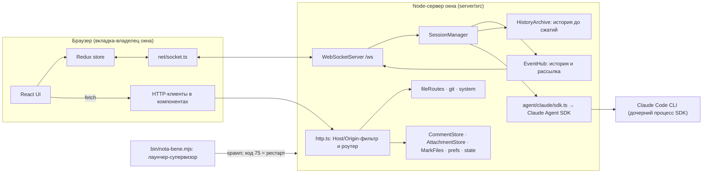
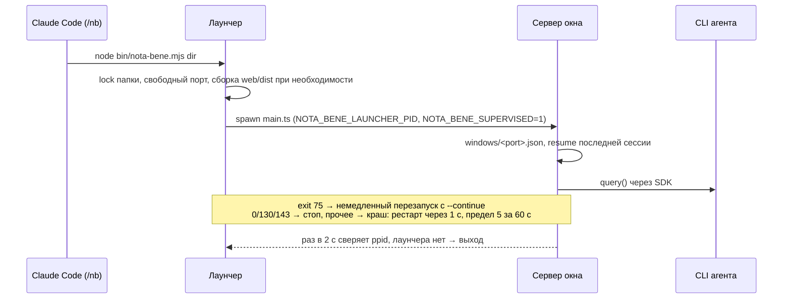
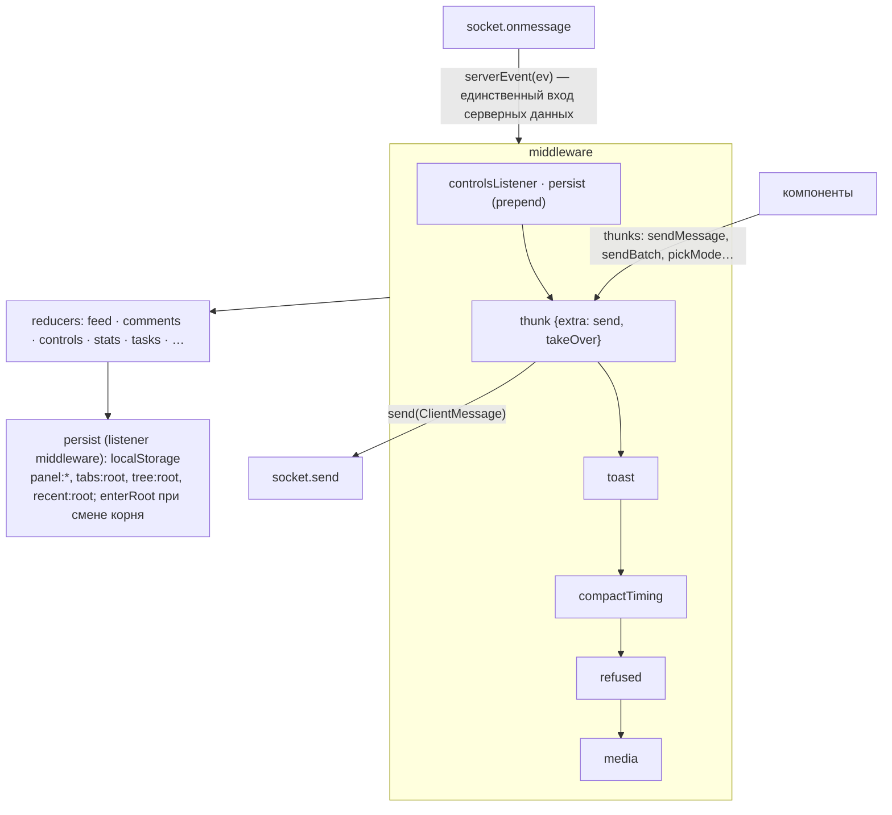
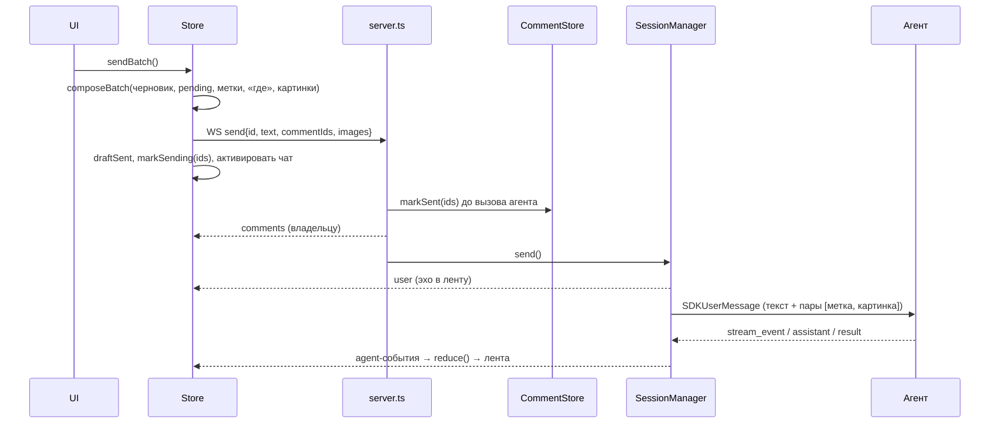

# Архитектура Nota Bene

Состояние на 2026-10-28, `main` (M7 влит). Около 15 тыс. строк исходников без тестов.

## 1. Общая картина

Nota Bene — локальное веб-приложение. Одно **окно** — это один процесс сервера, одна папка проекта, один порт из 4777–4799 и одна сессия Claude Code. С окном работает одна вкладка браузера (владелец); остальные видят «окно занято» и могут перехватить окно.



**Пакеты** (npm workspaces):

| Пакет | Что внутри |
|---|---|
| `shared/` | Один файл, `shared/src/protocol.ts`: типы протокола (`ClientMessage`, `ServerEvent`, `AgentEvent`, `Comment`, `Anchor`, `MediaShape`), валидатор `parseClientMessage` и версия `PROTOCOL`. Общий контракт web и server. |
| `server/` | Node ≥ 23.6 исполняет `.ts` напрямую, без сборки. Зависимости: `@anthropic-ai/claude-agent-sdk` и `ws`, больше ничего (HTTP-фреймворка нет). |
| `web/` | React 19, Redux Toolkit 2, Radix UI, Tailwind 4, Vite 8. Markdown на `marked` + `dompurify` + `highlight.js` + `mermaid`. |
| `bin/nota-bene.mjs` | Лаунчер: выбор порта, блокировка папки, сборка устаревшего `web/dist`, супервизия. |
| `plugin/skills/nb/` | Скилл `/nb` для Claude Code (внутри плагина `plugin/`): `open.sh --plan / --wait / --run`. |
| `e2e/` | Playwright на фейковом агенте (`server/src/agent/fake.ts`, `--fake script.json`). |

## 2. Процессы и жизненный цикл



- **Супервизия двусторонняя.** Лаунчер перезапускает сервер. Сервер сам выходит, если лаунчер исчез (`watchLauncher`). Переменные окружения лаунчера, унаследованные не от прямого родителя, сбрасываются (`dropInheritedLauncherEnv`), чтобы тестовый сервер, запущенный из окна, не считал себя супервизируемым.
- **Реестр окон** `~/.nota-bene/windows/<port>.json` нужен для «одно окно на папку» и для Settings → Windows.
- **Межоконное управление** (M6-15). Окно A шлёт `POST /system/windows/action`, его сервер проксирует запрос на `127.0.0.1:<port B>/control/<action>` с токеном из `<stateDir>/control-token` (права 600). `/control/*` отвергает любой запрос с заголовком `Origin`, так что достучаться туда может только сервер, не страница.

### 2.1 Пакет и флаг 3D

`scripts/build-package.mjs` собирает npm-пакет в `pkg/`: сервер и лаунчер бандлятся esbuild в JS с той же глубиной каталогов, что у исходников (поэтому относительные `import.meta`-пути к `web/dist` и blend-ассетам остаются верными), `@nota-bene/shared` вшит, `web/dist` собирается заново. В установленном пакете нет `web/src` и `.git`: лаунчер не собирает, `codeChanged` всегда false, версия берётся из `package.json`. 3D-просмотр экспериментальный и выключен по умолчанию (`NOTA_BENE_EXPERIMENTAL_3D=1`): сервер объявляет флаг в `hello.capabilities.model3d`, веб до этого hello считает модели обычными файлами.

## 3. Сервер

### 3.1 Модули

| Модуль | Ответственность |
|---|---|
| `main.ts` | Разбор аргументов, выбор цели resume, код 98 при занятом порту, сторож лаунчера. |
| `server.ts` | Композиция: создаёт хранилища, `SessionManager`, HTTP-роутер и WSS. Здесь же диспетчер WS-сообщений и связка «комментарии ↔ сессия». Одна вкладка на окно: владелец-сокет, перезагрузка владельца в пределах 700 мс (grace) не считается второй вкладкой, пинг владельца раз в 30 с (нет pong — `terminate`), `takeover` (старому владельцу `taken-over` и закрытие кодом 4001), пассивное переподключение `?passive=1`. Сообщения, которые запрещают `capabilities` агента, отвергаются как `server-error`. |
| `http.ts` | Без фреймворка. Порядок: Host allowlist → `/control/` (токен, без Origin) или Origin для не-GET → prefix-роуты (`/attach/`, `/marks/`, `/control/`) → точные роуты → `/info` → статика `web/dist` с SPA-фолбэком. |
| `hub.ts` | `EventHub`: in-memory история событий текущей сессии. При подключении сокет получает `replay` (с `earlier` — числом архивных сегментов), затем живые события. `reset()` подменяет историю (switch, `/clear`, restart); `cut()` отрезает всё до границы компакции в архив, часть событий (ещё не завершённые отправки) остаётся и в истории, и в архиве. |
| `archive.ts` | `HistoryArchive`: `history/<sid>.jsonl`, по строке на сегмент (разговор до очередного сжатия), fsync при записи, битая строка пропускается. Роут `/history?session=&before=`. |
| `subagent.ts` | Роут `GET /subagent?session=&tool=` (протокол 7): беседа субагента, которого запустил вызов Agent с tool-use id `tool`. Ответ `{events, running, type, description}`; 400 для id не из `[A-Za-z0-9_-]` (оба id попадают в пути файлов), 409 для не текущего разговора (как `/history`), 404 если субагента нет. Идёт через `AgentBackend.subagent(...)`: реальный бэкенд берёт id агента из `agent-<id>.meta.json` (`toolUseId`; не API SDK, читается в одном месте, `agent/claude/subagents.ts`), запасной путь — строка `agentId: …` в результате вызова; сообщения — `getSubagentMessages` через `transcriptToEvents(..., { subagent: true })` (SDK помечает каждое сообщение субагента id родительского вызова, живой маппер счёл бы их вложенными и выбросил текст). `running` — из `finished` / `stoppedByUser` в meta. |
| `taskOutput.ts` | Роут `GET /task-output?session=&task=` (протокол 8): хвост вывода фоновой shell- или Monitor-задачи, `{output, totalBytes, truncated, running}` (до 8 КиБ, с escape-последовательностями — чистит клиент). Правила как у `/subagent`: 400 для id не из `[A-Za-z0-9_-]`, 409 для не текущего разговора, 404 если сервер не знает задачу (`hub.task(id)`) или она не shell; 502, если агент не ответил. `running` читается ДО вывода: `false` значит, что вывод прочитан после конца задачи. Идёт через `SessionManager.taskOutput` → `AgentSession.taskOutput` (реальный: управляющий запрос SDK `get_task_output`). |
| `blend.ts`, `blend/export.py` | Роут `GET /model?path=&src=` (только `.blend`, иначе 400): файл конвертируется в GLB локальным Blender и отдаётся как `model/gltf-binary`. Путь, песочница и `src=` — те же, что у `/file` (`resolveInRoot`; ветка читается как blob, остальное — файл). **Поиск Blender** (`findBlender`): `NOTA_BENE_BLENDER`, если задана (авторитетна: неверный путь = «нет Blender», без отката к другим), иначе `blender` в PATH, иначе `/Applications/Blender.app/Contents/MacOS/Blender`; `/info.blender` — найден ли (протокол не менялся: добавлено поле `/info`). **Безопасность** (.blend может прийти от агента): всегда `-b --disable-autoexec --factory-startup --offline-mode -noaudio --python-exit-code 1`, `spawn` с массивом аргументов (не shell), в Python-код ничего не подставляется: путь вывода и разрешённые корни идут после `--` в `sys.argv` фиксированного `blend/export.py`; окружение дочернего процесса урезано до PATH/HOME/TMPDIR/LANG (ключи и токены сервера не передаются), cwd — временная папка. Файл проекта (этот checkout или worktree) Blender открывает **на месте**, чтобы `//tex.png` находили соседей; хеш считается до и после, при расхождении (файл менялся) ответ отдаётся, но в кеш не кладётся. Blob ветки пишется во временный файл. **Ссылки наружу:** `export.py` до экспорта проверяет `bpy.utils.blend_paths(absolute=True, packed=False)` (картинки, библиотеки, шрифты, звуки, movie clips, тома, cache-файлы, strips; запакованные данные не в счёт) относительно `realpath` корня источника (для blob ветки корней нет: разрешены только запакованные данные) и каталога установки Blender, и отказывает при любом узле `GeometryNodeImport*` в любой группе (Import Text/CSV/OBJ/PLY/STL/VDB читают произвольный файл, путь может быть вычисляемым) → 422 `{error:'outside-refs', paths}`, вкладка показывает пути. Проверено на 5.2.1: звуки, тома и movie-strips `blend_paths` перечисляет; картинки, клипы и шрифты нельзя создать без существующего файла, их покрытие — по устройству BPath. `/model` отказывает на `Sec-Fetch-Site` не `same-origin`/`none` (это первый GET, запускающий процесс). Дочерний Blender отслеживается: `close()` сервера и событие `exit` процесса убивают его SIGKILL, work-папки старше часа убираются при первом запуске. Статическая проверка дополнена тем, что `blend_paths` не перечисляет: дисковый bake в узлах геометрии (его meta-файл называет blob-файлы с `../`, то есть читается любой файл; запакованные bake разрешены), внешний point cache, каждый тайл UDIM / UVTILE по realpath. **Песочница ОС (глубокая защита):** на macOS Blender запускается под `/usr/bin/sandbox-exec` с фиксированным профилем `blend/sandbox.sb` (deny default): чтение только системы, установки Blender, realpath корня источника (для blob ветки — work-папки) и work-папки, запись только в work-папку, сети нет; пути идут параметрами `-D`, не в текст профиля; `HOME` и `TMPDIR` дочернего процесса — work-папка. Статическая проверка остаётся (даёт внятную причину и работает без песочницы); тест отключает её переключателем `skipStaticCheck` (только для тестов) и показывает, что утечку тайла останавливает одна песочница. Не macOS (или нет `sandbox-exec`): Blender запускается как раньше, один раз пишется предупреждение. Если `sandbox-exec` не может примениться (сервер сам внутри песочницы), конвертация падает, а не молча идёт без неё. Остаточный риск: ошибки парсера Blender внутри песочницы. **Кеш** `<NOTA_BENE_HOME>/cache/blend/<ключ>-<версия Blender>.glb` (версия из `Blender --version`, один раз на бинарник); попадание отвечает без запуска; ETag = хеш. **Очередь:** одна конвертация за раз на сервер, одинаковые запросы в полёте делят одну, таймаут 120 с (SIGTERM, через 3 с SIGKILL) → 504. Нет Blender → 501 `{error:'no-blender'}`; сбой экспорта (в том числе пустой результат) → 422 `{error, detail}` с последними строками вывода Blender. Ключ кеша — sha256 от (хеш содержимого, `realpath` корня источника, `realpath` папки файла): те же байты в другой папке или проекте конвертируются и проверяются заново. |
| `session.ts` | `SessionManager`, фасад (316 строк): `pump()` и склейка частей, публичные методы (`send`, `switchTo`, `restart`, `setMode`, …). |
| `session/` | Части менеджера: `phase` (фаза `live / switching / closed`), `turns` (`TurnLedger`: учёт отправок), `permissions` (`PermissionBroker`), `title`, `agentSlot` (агент и поколение `gen`), `identity` (id, корень, модель, форк), `mode`, `sendQueue`, `target` (проверка цели switch), `archiveCut` (отрез по `compacted`), `history` (загрузка ленты), `idleWiring`, `images`, `options`, `types`. |
| `agent/types.ts` | Интерфейсы `AgentBackend` / `AgentSession`, шов для подмены агента. Агент отдаёт `AgentEvent`; `capabilities` объявляют, что он умеет (режимы, команды, fork, idle-compact). |
| `agent/claude/sdk.ts` | Реальный backend: `query()` со streaming input (`InputQueue`), `canUseTool` → `PermissionAsk`, preset-промпт `claude_code` + `APPEND` (mermaid, пути к файлам, батчи комментариев). |
| `agent/claude/map.ts` | Перевод SDK-кадров в `AgentEvent`: единственное место, где ключи SDK попадают в поток. |
| `agent/fake.ts` | Скриптуемый backend для e2e. |
| `agent/claude/transcript.ts` | Транскрипт → `ServerEvent[]` для replay; картинки уходят в `AttachmentStore`. |
| `comments.ts` | `CommentStore`: `comments/<sessionId>.json`. Сессия без id живёт в памяти, `adopt()` переносит её под настоящий id. |
| `attachments.ts` | Content-addressed картинки (`sha256.ext`) до 3.75 МБ. `POST /attach`, `GET /attach/<id>`, восстановление из корзины. |
| `marks.ts` | Единственная запись в папку проекта: `<root>/.nota-bene/marks/<commentId>/{frame.jpg,layer.png}`. Проверка magic bytes, запрет симлинков. |
| `fileRoutes.ts`, `files.ts`, `git.ts` | `/tree`, `/file` (Range, sandbox-заголовки), `/complete`, `/sources`, `/git-status`. Источники: текущий checkout, другие worktree (с диска) и ветки (через git blobs). |
| `system.ts` | Settings: about, prefs, storage (включая `history/`) и очистка в корзину (в том числе устаревших архивов), окна, контрольный токен. |
| `prefs.ts`, `state.ts`, `windows.ts` | JSON-файлы состояния (запись через tmp + rename). |
| `stats.ts`, `idle.ts` | Контекст, лимиты и стоимость (опрос SDK). Автокомпакция после простоя: 50 мин после хода, 15 мин без активности, контекст от 200k токенов. |

### 3.2 SessionManager: как устроен

`createSessionManager` — фасад в `session.ts`: он владеет `pump()` и связывает части из `session/`. Каждая часть владеет своим состоянием, строгость — там, где переход делает сам сервер.

- **Фаза окна (`Phase`).** `live → switching → live` и необратимый `closed`. Закрытие посреди switch делает фазу `closed` сразу, но `switching` держится до `endSwitch()`; новый агент не стартует.
- **Учёт отправок (`TurnLedger`).** Каждая отправка: `queued → running → answered | cancelled | failed`. Флаги `/clear` и `/compact` (`commandDue`, сброс, компакция внутри хода) живут здесь же. Строго там, где шаг делает сервер; терпимо там, где его делает CLI (turn-end по неизвестному или уже закрытому id игнорируется).
- **Агент и поколение (`AgentSlot`).** Поколение `gen` растёт при каждом teardown (switch, close). Всё, что старый агент может прислать позже (сообщения, запросы разрешений, ответы на mode и title, отложенный send), несёт своё `g` и отбрасывается при `g !== gen`. Это главная защита от утечки событий старой сессии в новую.
- **`SendQueue`** заменила `chain`: отправки уходят агенту по одной, так что interrupt `force`-отправки приходит после предыдущих отправок и до неё; отправка из прошлого поколения тихо отбрасывается.
- **`PermissionBroker`**: запрос `open → answered | aborted`; ответ на неизвестный или закрытый запрос игнорируется (второй сокет, клик после отзыва).
- **`pump()`** читает `a.messages` — поток `AgentEvent` (SDK-кадры переводит `agent/claude/map.ts`):
  - сводит `waiting` с `turn-end` по `answers` и с `cancelled`;
  - перехватывает `reset` (`/clear`);
  - следит за `init` (id сессии, модель, режим, запись в `sessions.json`) и `compacted`;
  - всё, кроме `init` и `rate-limit` (они внутренние), отдаёт в hub как `{kind:'agent', e}` (протокол 5).
- **Отрез по компакции (`archiveCut`).** После события `compacted`, в том же синхронном шаге, где проверено поколение, `hub.cut()` пишет в архив разговор до границы; в replay остаётся то, что после неё, плюс ещё не завершённые отправки (в том числе сам `/compact`). Ошибка записи сообщается и ничего не режет. У разговора без собственного id (новая сессия до `init`, форк до нового id, сессия после `/clear`) отреза нет, и **форк никогда не предлагает архив родителя**: `SessionIdentity.ownId` для него `null`, `earlier` в replay равен 0, `/history` отвечает 409.
- **`switchTo`**: проверка цели (`target`) → teardown (`gen++`, close агента, ожидание конца loop не дольше 5 с) → новое состояние → `load()` (`hub.reset` + replay транскрипта + `resumed`) → mode/idle/stats → `onSwitch`-слушатели → `ensureAgent()`. Новую сессию можно открыть только в текущем корне или в папке, где сессии уже есть: локальный клиент не должен переукоренить `/file` на `/` или `~`.
- **`restart`** — `switchTo(sessionId, root, restart=true)`. Это аварийный выход: он разрешён и при занятом агенте (interrupt не дольше 2 с).

### 3.3 Протокол

Два канала с чётким разделением:

| Канал | Что идёт | Почему так |
|---|---|---|
| **WebSocket `/ws`** | Живое состояние сессии: `agent` (`AgentEvent`), `user`, `permission*`, `session`, `mode`, `stats`, `comments`, `idle-compact`, `hello{capabilities}`, `replay{earlier}`, `send-refused`, `server-error`; владение окном: `occupied`, `taken-over`, от клиента `takeover`, закрытие кодом 4001 | Нужен push и порядок событий; приёмник один — вкладка-владелец. |
| **HTTP** | Файлы, дерево, поиск, вложения, разметка медиа, список сессий, `/history` (архив до сжатий), `/subagent` (беседа субагента), `/task-output` (хвост вывода shell-задачи), `/model` (.blend → GLB через Blender), Settings, `/info`, `/restart-server` | Запрос–ответ, кешируемо, Range для видео. |

Правила протокола:

- `parseClientMessage` строго валидирует входящие сообщения и **пересобирает их только из известных полей** (`toComment`, `toAnchor`), так что посторонние ключи не попадают ни в хранилище, ни в рассылку.
- **Эпизодические события** не хранятся в истории (`store:false`): `comments`, `stats`, `mode`, `idle-compact`. При подключении сокет получает их отдельными кадрами после replay, последним идёт `hello{protocol}`.
- **Субагенты (протокол 7).** Якорь сообщения может называть субагента: `{kind:'message', id, agent?}`, где `agent` — tool-use id вызова Agent (`isAnchor`/`toSource` пропускают только такое поле; id проверяется как простой id). Клиент отдаёт выделение во вкладке субагента (и шлёт такие комментарии) только серверу с протоколом ≥ 7, иначе старый сервер молча потерял бы поле и отнёс комментарий к основному чату. В батче: `ответ субагента «описание»` (без номеров, как простой `ответ`), для действия `команда Bash (npm test) · субагент «описание»`; цитата остаётся локатором. Комментарий к не загруженной беседе показывается как осиротевший, не пропадает; «к источнику» открывает вкладку и ищет фрагмент.
- **Версионирование.** Все окна раздают один общий `web/dist`, поэтому перезагруженная страница может оказаться новее своего сервера. Клиент шлёт новые типы сообщений только серверу, который объявил нужный `PROTOCOL` (сейчас 9). Протокол 9: якорь медиа-комментария может нести `camera {position, target, fov}` (комментарий к виду 3D-модели); сервер старше 9 выбросил бы поле, поэтому разметку на вкладке модели клиент предлагает только серверу ≥ 9. Протокол 6: переключение модели и effort. Протокол 7: якорь субагента и `/subagent`. Протокол 8: клиентские `task-stop {id}` и `task-background {toolUseId}` (отказ или «нечего переводить в фон» приходит событием `server-error` с `where: 'task'`, то есть тостом) и `/task-output`; без него клиент не показывает Stop / «В фон» и не открывает вкладку shell-задачи (кнопок нет, а не disabled). Протокол 5: поток `agent` вместо сырых SDK-кадров, `replay.earlier`, одна вкладка на окно (`occupied`, `taken-over`, `takeover`, код 4001, `?tab=` и `?passive=1` в url сокета), `hello.capabilities`. Обратный перекос (страница новее сервера) защищён тем, что `default`-ветки редьюсеров возвращают state для неизвестного `kind` и `t`, а не падают; порядок при выкладке — сначала рестарт сервера, потом перезагрузка страницы.

### 3.4 Хранилища (сервер)

```
~/.nota-bene/              (NOTA_BENE_HOME; dev: ~/.nota-bene-dev)
├── sessions.json          последняя сессия по папке
├── prefs.json             modes[root], idleCompact[root], defaultMode, lang
├── comments/<sid>.json    комментарии сессии (pending + sent)
├── attachments/<sha>.<ext>, trash/attachments/<stamp>/
├── history/<sid>.jsonl    архив разговора до каждого сжатия, trash/history/<stamp>/
├── cache/blend/<sha>-<версия>.glb   результат конвертации .blend (пересоздаваем; в Settings → Storage не включён)
├── windows/<port>.json    реестр окон
├── locks/<hash>           блокировки запуска
└── control-token          межоконный токен (600)
<project>/.nota-bene/marks/<commentId>/{frame.jpg,layer.png}
```

Источник ленты — **транскрипт Claude Code** (`~/.claude/projects/...`), но SDK воспроизводит сессию только с последней компакции. Разговор до каждой компакции сервер хранит сам в `history/<sid>.jsonl` (`HistoryArchive`, потоковые кадры не пишутся); после последней компакции источник по-прежнему транскрипт. После рестарта лента восстанавливается из транскрипта через `backend.history()`, а число архивных сегментов приходит в `replay.earlier`.

## 4. Веб-клиент

### 4.1 Организация по фичам

Каталоги `web/src` нарезаны по фичам, а не по слоям. В каждом лежат свой `slice.ts`, компоненты и чистая логика:

| Каталог | Содержимое |
|---|---|
| `store/` | `store.ts` (сборка store, socket, middleware), `persist.ts` (listener middleware: сохранение UI-состояния, вместо `store.subscribe`) и `feed.ts` (чистый редьюсер ленты из `AgentEvent`, плюс `prependHistory`). |
| `net/socket.ts` | WebSocket с автопереподключением через 1 с; `open` значит «подключён» (пришёл replay), а не открытие сокета; после 4001 переподключения нет, есть `reconnect()` по клику. В Redux не попадает. |
| `feed/` | Рендер ленты: Markdown, ToolLine, PermissionCard, PlanCard, DoneLine; `EarlierButton` «Показать до сжатия» и `history.ts` (`GET /history`). |
| `diagram/` | Вкладка с диаграммой (mermaid): рендер, зум. |
| `model/` | Вкладка 3D-модели (`.glb` / `.gltf` / `.blend`, только просмотр; `.blend` берётся с `GET /model` (`modelUrl` в `files/kinds.ts`), пока Blender конвертирует, панель пишет «Blender конвертирует…» (прогресса сервер не даёт), без Blender (501) — строка про установку и места поиска, под инфо-строкой пометка «сконвертировано Blender»; `kindOf` → `model`). Не медиа для `MediaController`. Комментарии к виду (шаг B): `files/view/ModelMarkup.tsx` кладёт поверх канваса тот же `MarkupLayer` / `MediaMarks` (канвас — третий вид `Media`); режим разметки замораживает `OrbitControls` (`setFrozen`) и ставит клип на паузу (время клипа в комментарий не входит), якорь — `MediaAnchor` с `camera` и размером канваса, кадр рисуется прямо из канваса (`renderNow` перед чтением), без `time`. Метки комментария видны, только пока камера в его позе (`nearPose`: тысячная доля расстояния до цели; `registry.publishViewPose`), остальные доступны чипами «видов» над канвасом (клик → `setPose`); «перейти к источнику» после `ready` делает `setPose`. Три чанка: основной несёт только `files/view/ModelPane.tsx` (загрузчик, ~2 КБ), `files/view/ModelBody.tsx` (состояния, лимит 256 МБ, чтение с прогрессом; свой чанк; потеря WebGL-контекста: вьюер уничтожается, ↻ создаёт новый и разбирает сохранённые байты; скрытая вкладка через 20 с отдаёт контекст и возвращает его с той же камерой — у браузера их около 16 на страницу) и `model/viewer.ts` (весь three: `GLTFLoader`, `OrbitControls`, `DRACOLoader`, `KTX2Loader` (текстуры KTX2 / Basis; `detectSupport(renderer)`), `MeshoptDecoder`, PMREM `RoomEnvironment`; чанк ~690 КБ) подгружаются динамическим `import()` при первом показе вкладки. Draco-декодер и транскодер Basis — хешированные ассеты нашей сборки (`dist/assets/draco_*`, `dist/assets/basis_transcoder-*`: three задаёт их через `new URL(…, import.meta.url)`, Vite кладёт файлы в сборку; грузятся при первой такой текстуре, воркер создаётся тогда же), meshopt вшит в чанк; ничего с CDN. `resolve.ts` — чистая функция: внешние `.bin` и текстуры `.gltf` берутся через `/file` относительно папки модели и с тем же `src`; `data:` и `blob:` как есть, `http(s):` и `//host` отклоняются. Рендер по требованию (контролы, resize, играющая анимация), скрытая вкладка не рисует, `dispose` освобождает геометрии, материалы, текстуры, контекст. `registry.ts` отдаёт вьюер вкладки наружу (`getPose`, `setPose`, `renderNow`, `snapshot`) и живую позу камеры (`publishViewPose` / `subscribeViewPose`). |
| `tasks/` | Задачи (M2, шаг 2). `slice.ts` (`tasks` — `reduceTasks` из `shared`: и бегущие, и последние 20 завершённых, со `status` `running / done / failed / stopped`, `end`, `kind` `agent / shell / other`, `parent`; `tasksUi.open` — открыт ли ящик; селекторы `selectRunningCount` — по нему считают индикатор, пульс и favicon, `selectTaskRows` — строки с вложенностью по `parent_task_id`), `TasksDrawer.tsx` (нижний ящик: оверлей `absolute` поверх колонки панелей, не меняет размер ленты; закрывается Esc (capture-фаза + `preventDefault`, чтобы Esc композера не прервал агента), кликом снаружи, индикатором и Alt+T), `TaskButtons.tsx` (Stop с подтверждением «Stop?» на 3 с, «В фон» только для бегущей задачи, которая блокирует свой вызов: CLI говорит это сам (`is_backgrounded` из `task_started` и `task_updated.patch` → `bg`), а если не сказал — вызов без результата и (для задачи основного потока) идущий ход; после нажатия «Останавливаю…» до ответа или отказа сервера), `CardMenu.tsx` (меню «⋯» на карточке субагента), `ShellView.tsx` (вкладка `shell:<taskId>`: `/task-output` раз в секунду, пока вкладка видима и задача идёт, ещё одно чтение после её конца; `ansi.ts` убирает escape-последовательности, не интерпретируя их; липнет к низу, только если уже был внизу), `time.ts`. Наблюдатели (`ambient`, shell / Monitor) показываются в ящике, но не считаются в индикаторе, пульсе и favicon; ребёнок, который ещё бежит, остаётся среди бегущих строк вместе со своим завершившимся родителем. Индикатор под композером — `shell/TasksIndicator.tsx`: `⚙ N задач` (пульс), при одних завершённых тихо `✓ N`, без задач скрыт. Вкладки `shell` хранятся по корню, как `agent`. |
| `subagent/` | Вкладка `agent:<toolUseId>` (M2, шаг 1): беседа субагента только для чтения. `slice.ts` (`subagents.byTool`: загруженная лента через тот же `reduce()` от `emptyFeed`, отдельно от `feed`; `fetchSubagent`), `AgentView.tsx` (панель: `data-chat-pane` + `data-agent`, тот же `Feed`, без композера; опрос раз в 1,5 с, пока агент работает и вкладка видима). Вызов Agent / Task в основной ленте — карточка (тип, описание, статус, «открыть»); подряд идущие действия она не склеивает. |
| `composer/` | Поле ввода, `@`-упоминания (`/complete`), откат отклонённой отправки (`refused.ts`). |
| `comments/` | Выделение → popup → карточка, панель, `HighlightLayer`, сборка батча (`compose.ts`, `send.ts`), метки, эмодзи. |
| `anchors/` | Якоря как текстовые смещения плюс `quote/prefix/suffix` по 32 символа, повторная привязка при изменении текста (`resolve.ts`). |
| `files/`, `tree/`, `tabs/` | Дерево, просмотр файлов, иконки, недавние (Alt+E), источники (ветки и worktree), вкладки и меню ▾. Подпапки: `files/tree` (`TreeRow`, `useTreeEntries`), `files/view` (`TextBody`, `MediaBody`, `ModelPane` / `ModelBody`, `useFileLoad`), `comments/card` (`CardActions`, `useCommentSource`). |
| `media/` | `MediaController` (пауза и PiP между вкладками), разметка `markup/` (геометрия 0..1, рендер в `frame.jpg` + `layer.png`). |
| `controls/` | Режим, переключатель сессий, compact/clear, restart, idle-компакция. |
| `settings/`, `shell/`, `stats/`, `tasks/` | Вкладка Settings; шапка, футер, полосы, keymap, тосты, favicon, `OneTab` (оверлей «окно занято» / «открыто в другой вкладке»); метры; фоновые задачи. |
| `refs/` | Распознавание путей в тексте и переход в файл (`src/a.ts:42`). |
| `components/ui/` | Обёртки над Radix (shadcn-стиль). |
| `i18n/` | `ru` / `en`, без библиотеки. |

### 4.2 Store

13 слайсов: `feed`, `conn`, `comments`, `composer`, `tabs`, `tree`, `files`, `controls`, `stats`, `tasks`, `tasksUi`, `markup`, `feedUi` (и `subagents`).



Принципы:

- **Один вход.** Серверные данные приходят только как action `serverEvent(ev)`. Его обрабатывают сразу несколько слайсов через `extraReducers`. Редьюсер ленты `reduce()` — чистая функция, поэтому replay детерминирован.
- **Несериализуемое вне state.** Сокет живёт в замыкании `makeStore` и доступен thunk'ам через `extraArgument` (`send`, `takeOver`). `MediaController` (держит DOM-элементы) лежит в `WeakMap` и достаётся хуком `useMedia`.
- **Побочные эффекты — в middleware, а не в редьюсерах**: тосты, отслеживание PiP и паузы, откат черновика при `send-refused`.
- **Persistence UI** сосредоточена в `store/persist.ts`: по listener'у на каждую заботу, каждый сравнивает state до и после action. При смене корня (`feed.session.root`) первый listener читает сохранённые вкладки и дерево этого корня и диспатчит `enterRoot`; он зарегистрирован первым, поэтому остальные видят уже восстановленное.
- **Pending-состояние отправки** без оптимистичных обновлений: комментарий становится `sent` только по эхо сервера, до этого его id лежат в `sendingIds`.

### 4.3 Композиция UI

```
App
├── Header (сессия, режим, ⚙, язык, ↻ + ▾ RestartMenu)
├── LeftStrip · FileTree (key=rootGen) │ TabStrip + TabsMenu │ CommentsPanel · RightStrip
│                                       Panes: chat (Feed + HighlightLayer) | FileView×N | DiagramView | Settings
│                                       Footer (Composer, метры, задачи)
└── оверлеи: SelectionButton, CommentPopup, CommentCardPopover, Toasts, RecentFiles, OneTab
```

- **Крупные компоненты разнесены на композицию:** `FileTree` = `TreeHeader` + `TreeRow` + хуки `useTreeEntries`/`useExpandAll`; `FileView` = `TextBody`/`MediaBody` + `useFileLoad`/`useMediaMarkup`; `CommentCard` = `CardActions` + `useCommentSource`.
- **Панели закреплены** (R-M6-3): открытая панель сужает среднюю колонку, а не перекрывает её.
- **Все панели вкладок остаются смонтированными**, неактивные просто `hidden`. На стабильный DOM чата опираются якоря, `HighlightLayer` и автоскролл.
- **Подсветка** рисуется прямоугольниками `Range.getClientRects()` в слое поверх контента, DOM текста не трогается.
- **Горячие клавиши** — один модуль `shell/keymap.ts`: один document-listener, матчинг по `code`, по умолчанию Alt, учёт модальных окон и полей ввода.

### 4.4 Интеграция с сервером

| Клиент | Сервер | Назначение |
|---|---|---|
| `store.ts` → `net/socket.ts` | `/ws?tab=<id>` (`&passive=1` у занятой или перехваченной вкладки) | Всё живое состояние сессии. |
| `tasks/ShellView.tsx` | `GET /task-output?session&task` | Вывод shell-задачи; 404 / 409 — «сервер больше не знает эту задачу», сбой чтения — строка и прошлый вывод остаётся, повтор через 3 с. |
| `subagent/slice.ts` (`fetchSubagent`), `subagent/AgentView.tsx` | `GET /subagent?session&tool` | Беседа субагента; 404 / 409 — «этого субагента нет в текущей сессии», остальные ошибки — строка в панели. Комментарии к ней уходят в основную сессию. |
| `feed/history.ts`, `feed/EarlierButton.tsx` | `GET /history?session&before` | Архивный сегмент до сжатия; 409 для не текущей сессии, 404 если сегмента нет. |
| `comments/slice.ts` (`resyncComments`, add/edit/remove) | WS `comments` (полный набор) | Синхронизация комментариев; сервер делает `merge`, защищая `sent`. Пишет только вкладка-владелец. |
| `comments/send.ts` → `sendMessage` | WS `send{commentIds, images}` | Батч: черновик + все pending-комментарии одним сообщением. |
| `attachments/image.ts` | `POST /attach`, `GET /attach/<id>` | Загрузка картинок; по сокету ходят только id. |
| `media/markup/createMediaComment.ts` | `POST/DELETE /marks/<id>/<name>` | Кадр и слой разметки медиа. |
| `files/FileTree.tsx` | `/tree?path&src` | Ленивая загрузка дерева, до 8 запросов параллельно. |
| `files/view/ModelBody.tsx` | `GET /model?path&src` (только `.blend`) | Тот же ArrayBuffer-путь, что у `/file`; 501 → «нужен Blender», 422 / 504 → текст ошибки из `{detail}`. |
| `files/FileView.tsx` | `/file` (HEAD, Range-проба, GET) | Просмотр; ETag как версия для якорей медиа. Модель (`ModelBody`): один GET как ArrayBuffer (размер из `content-length`, больше 256 МБ не читается), без HEAD и пробы; перезагрузка по тому же ETag не читает тело (оно отменяется после заголовков) и не парсит файл заново. |
| `composer/MentionPicker.tsx`, `files/RecentFiles.tsx` | `/complete?q` | Поиск CLI (`file_suggestions`) и свой индекс файлов параллельно, результаты сливаются. |
| `files/sources.ts`, `shell/GitBranch.tsx` | `/sources`, `/git-status` | Ветки и worktree, бейдж ветки. |
| `controls/SessionPicker.tsx` | `/sessions` | Все сессии Claude Code с их cwd. |
| `shell/RestartMenu.tsx`, `controls/slice.ts` | `/info`, `POST /restart-server` | Пункт «Перезапустить сервер» (только под лаунчером). |
| `settings/SettingsView.tsx` | `/system/*` | Окна, хранилище, настройки по умолчанию, about. |

## 5. Сквозные сценарии

**Отправка батча комментариев:**



**Смена сессии или папки:**

1. Клиент шлёт `switch{id, dir}`.
2. `checkTarget` проверяет цель, затем teardown с `gen++`.
3. `hub.reset(transcript)` перерисовывает ленту у владельца.
4. Сервер шлёт `session{root}`, и listener в `persist` видит новый корень: `enterRoot` (вкладки и дерево этого корня), `rootGen++` (перемонтирование `FileTree` и `FileView`), сброс кешей.
5. `onSwitch` присылает комментарии новой сессии.

**Компакция и «Показать до сжатия»:**

1. Агент присылает `compacted`; `pump()` отдаёт его в hub, затем `archiveCut.cut()` (в том же синхронном шаге, где проверено поколение).
2. `hub.cut()` пишет в `history/<sid>.jsonl` всё до границы (сегмент `n`), оставляя в истории то, что после неё и ещё не завершённые отправки. Ни один живой сокет об отрезе не слышит: у них лента уже полная.
3. Перезагруженная страница получает короткий `replay` с `earlier = n`, лента показывает кнопку «Показать до сжатия».
4. Клик: `GET /history?session=<id>&before=earlier+1` → `prependHistory` вставляет сегмент перед лентой, `earlier` уменьшается; пустой 404 убирает кнопку, 409 (разговор уже другой) показывает ошибку.

**Перехват окна (takeover):**

1. Вторая вкладка подключается, владелец есть: через 700 мс она получает `occupied` и показывает оверлей «Окно уже открыто в другой вкладке».
2. «Работать здесь» шлёт `takeover`. Сервер шлёт старому владельцу `taken-over`, отцепляет его и закрывает кодом 4001; новая вкладка прикрепляется как при обычном подключении и получает `replay`.
3. Старая вкладка показывает «Открыто в другой вкладке» с той же кнопкой «Работать здесь» и не переподключается сама; её несинхронизированные правки комментариев отбрасываются.

**Перезагрузка владельца в пределах grace:**

1. Новая страница получает новый `?tab=<id>`, а сокет старой ещё не закрыт: сервер держит новый сокет в ожидании (`pending`), оверлея нет.
2. Старый сокет закрывается в пределах 700 мс (`owner` пуст) — новичок становится владельцем и получает `replay`. Не закрылся — новичок получает `occupied`.
3. Тот же `tab` у владельца значит переподключение той же страницы после обрыва (старый сокет — зомби): его закрывают сразу, без ожидания.
4. После рестарта сервера обе вкладки переподключаются пассивно (`&passive=1`): пассивный сокет не может занять пустое окно первым, он получает `occupied` и работает дальше только по клику «Работать здесь».

## 6. Безопасность (локальная модель угроз)

- **Сеть.** Сервер слушает только `127.0.0.1`, разрешены `Host` вида `127.0.0.1:port` или `localhost:port` (защита от DNS rebinding).
- **Методы кроме GET/HEAD** требуют `Origin` из allowlist (CSRF с чужих страниц). WS принимает соединения без Origin (локальные процессы) или с разрешённым Origin.
- **Разрешения инструментов.** Ответ клиента — только `allow: boolean`. `input` от клиента игнорируется: агент получает исходный ввод, переписать команду через UI нельзя.
- **Пути.**
  - `resolveInRoot` — песочница проекта;
  - `/file` отдаётся с sandbox-заголовками;
  - в `marks` путём становится только UUID, имена файлов фиксированы, симлинки отвергаются.
- **Межоконное управление.** Токен и запрет Origin. Перед любым действием проверяется, что окно в реестре то же самое (`root`, `pid`, `startedAt`), иначе 409; своё окно так не трогается.

## 7. Тестирование

- **Unit (vitest, 1450).** Сервер тестируется через `startServer` на порту 0 с фейковым backend. Web — через `makeStore` с подменой `connect` и `pip`.
- **E2E (Playwright, 48, порты 4791–4795)** на `--fake`-скриптах, медиа-фикстуры генерируются через ffmpeg.
- **Шов `AgentBackend`** — главная причина, по которой почти всё тестируется без настоящего CLI.

## 8. Критическая оценка

Сильные стороны:

- узкий общий контракт в `shared/`;
- строгая валидация на границе;
- генерации (`gen`) против гонок;
- единый вход серверных данных в store;
- отсутствие лишних зависимостей на сервере;
- хорошая тестируемость через шов backend.

Слабые места (оценка до M7; сделанное отмечено):

1. **Web зависел от формы SDK-сообщений. Сделано (M7).** Сервер отдаёт собственный поток `AgentEvent` (`agent/claude/map.ts` — единственный мост), `web/src/store/feed.ts` разбирает его, а не сырые `SDKMessage`; возможности агента объявляет `capabilities`. Остаётся: `agent/claude/sdk.ts` использует непубличные API (`q.request({subtype:'file_suggestions'})`, `usage_EXPERIMENTAL_...`), поэтому SDK обновлять вручную и с прогоном `server/test/fixtures/real-frames.json`.
2. **`SessionManager` — неявная машина состояний. Сделано (M7).** Фасад в 316 строк и части `session/`: `Phase`, `TurnLedger`, `AgentSlot`, `SendQueue`, `PermissionBroker`; строгие переходы там, где шаг делает сервер.
3. **Persistence-подписчик в `store.ts` был реентерабелен. Сделано (M7).** Перенесён в listener middleware (`store/persist.ts`).
4. **Комментарии синхронизируются полным набором.**
   - **Проблема.** Каждое изменение отправляет весь массив. Сервер защищает только `sent`; для `pending` действует last-writer-wins.
   - **Что изменила M7.** Одна вкладка на окно: пишет только владелец, гонка между вкладками возможна лишь в зазоре перехвата (несинхронизированные правки занятой и перехваченной вкладки отбрасываются при `occupied`/`taken`). Операции `add / edit / remove` с id нужны, если появится другой источник правок или сотни комментариев.
5. **История `EventHub` росла без ограничений. Сделано (M7).** Replay начинается с последней компакции, остальное лежит в `history/<sid>.jsonl` и догружается по запросу («Показать до сжатия»). Остаётся рост истории внутри одного периода между компакциями — незаметен.
6. **Крупные компоненты. Сделано (M7).** `FileView`, `CommentCard`, `FileTree` разнесены на композицию (`files/view`, `comments/card`, `files/tree`): хуки загрузки отдельно от рендера.
7. **Общий `web/dist` на все окна** порождает рассинхрон версий страницы и сервера, отсюда механизм `PROTOCOL`. Это осознанный компромисс (одна сборка, мгновенное обновление через reload). Цена — каждое новое сообщение протокола требует проверки версии на клиенте. Обратный перекос (новая страница, старый сервер): неизвестные `kind` и `t` не должны ронять редьюсеры (`default` возвращает state), а при выкладке сначала перезапускают сервер, потом перезагружают страницу.

## 9. Решения по итогам ревью (2026-10-27)

Порядок работ: П.3 и П.6 (только web) → П.2 → П.5 поверх новой машины состояний → П.4.

- **П.2 SessionManager.** Переделать в явную машину состояний сейчас, отдельной задачей, а не вместе с M2. Сначала характеризационные тесты на текущее поведение.
- **П.3 Persistence-подписчик.** Перенести на `createListenerMiddleware`: по одному listener'у на ключ, `enterRoot` как реакция на `serverEvent(session)`.
- **П.4 Комментарии.** Вместо операционной синхронизации ограничить работу одной вкладкой на окно: решает сервер (он видит все сокеты). Новая вкладка показывает «Окно уже открыто в другой вкладке» с кнопкой «Работать здесь»; после перехвата старая гаснет («Открыто в другой вкладке», кнопка вернуть). Жёсткий запрет отвергнут: забытая вкладка заблокировала бы работу, а гонка при перезагрузке давала бы ложное «уже открыто».
- **П.5 История EventHub.** Обрезать replay сразу после компакции, не дожидаясь замедления. Лента показывает переписку с последней компакции; кнопка «Показать до сжатия» догружает старую часть по HTTP, чтобы история и подсветки старых комментариев не терялись молча.
- **П.6 Крупные компоненты.** Разнести на композицию сразу: хуки загрузки данных отдельно от рендера.
- **§8.1 SDK и протокол (решение пользователя, 2026-10-27).** Развести SDK агента и протокол клиент–сервер: свой поток `AgentEvent` по образцу ACP, SDK только внутри адаптера Claude, возможности агента объявляются явно. Другие модели того же агента (DeepSeek, GLM) — настройка `ANTHROPIC_BASE_URL`, другие агенты (Codex, Gemini CLI, OpenCode) — позже через один ACP-адаптер. План: M7, пакет E, до машины состояний.
- **Машина состояний: где строгость.** Фаза окна (`live / switching / closed`) — строгая. `idle / turn / asking` выводятся из учёта отправок и разрешений, потому что ходы перекрываются; строгие переходы — у каждой отправки (`queued → running → answered | cancelled | failed`) и каждого запроса разрешения.
