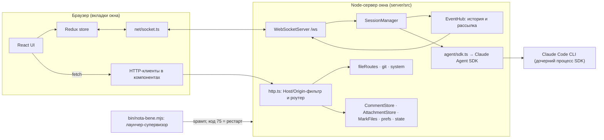
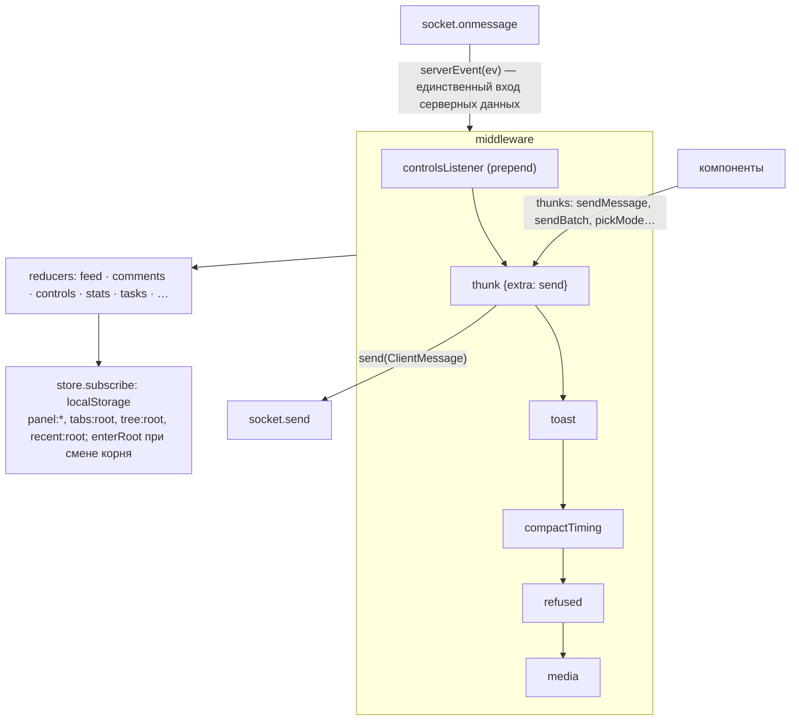

# Архитектура Nota Bene

Состояние на 2026-10-27, `main` @ 386f4da (M6 влит). Около 15 тыс. строк исходников без тестов, 103 тестовых файла.

## 1. Общая картина

Nota Bene — локальное веб-приложение. Одно **окно** — это один процесс сервера, одна папка проекта, один порт из 4777–4799 и одна сессия Claude Code. В окно может смотреть сколько угодно вкладок браузера.



**Пакеты** (npm workspaces):

| Пакет | Что внутри |
|---|---|
| `shared/` | Один файл, `shared/src/protocol.ts`: типы протокола (`ClientMessage`, `ServerEvent`, `Comment`, `Anchor`, `MediaShape`), валидатор `parseClientMessage` и версия `PROTOCOL`. Общий контракт web и server. |
| `server/` | Node ≥ 23.6 исполняет `.ts` напрямую, без сборки. Зависимости: `@anthropic-ai/claude-agent-sdk` и `ws`, больше ничего (HTTP-фреймворка нет). |
| `web/` | React 19, Redux Toolkit 2, Radix UI, Tailwind 4, Vite 8. Markdown на `marked` + `dompurify` + `highlight.js` + `mermaid`. |
| `bin/nota-bene.mjs` | Лаунчер: выбор порта, блокировка папки, сборка устаревшего `web/dist`, супервизия. |
| `skill/` | Скилл `/nb` для Claude Code: `open.sh --plan / --wait`. |
| `e2e/` | Playwright на фейковом агенте (`server/src/agent/fake.ts`, `--fake script.json`). |

## 2. Процессы и жизненный цикл

```mermaid
sequenceDiagram
  participant CC as Claude Code (/nb)
  participant L as Лаунчер
  participant S as Сервер окна
  participant A as CLI агента
  CC->>L: node bin/nota-bene.mjs dir
  L->>L: lock папки, свободный порт, сборка web/dist при необходимости
  L->>S: spawn main.ts (NOTA_BENE_LAUNCHER_PID, NOTA_BENE_SUPERVISED=1)
  S->>S: windows/<port>.json, resume последней сессии
  S->>A: query() через SDK
  Note over S,L: exit 75 → немедленный перезапуск с --continue<br/>0/130/143 → стоп; прочее → краш, рестарт через 1 с, предел 5 за 60 с
  S-->>L: раз в 2 с сверяет ppid; лаунчера нет → выход
```

- **Супервизия двусторонняя.** Лаунчер перезапускает сервер. Сервер сам выходит, если лаунчер исчез (`watchLauncher`). Переменные окружения лаунчера, унаследованные не от прямого родителя, сбрасываются (`dropInheritedLauncherEnv`), чтобы тестовый сервер, запущенный из окна, не считал себя супервизируемым.
- **Реестр окон** `~/.nota-bene/windows/<port>.json` нужен для «одно окно на папку» и для Settings → Windows.
- **Межоконное управление** (M6-15). Окно A шлёт `POST /system/windows/action`, его сервер проксирует запрос на `127.0.0.1:<port B>/control/<action>` с токеном из `<stateDir>/control-token` (права 600). `/control/*` отвергает любой запрос с заголовком `Origin`, так что достучаться туда может только сервер, не страница.

## 3. Сервер

### 3.1 Модули

| Модуль | Ответственность |
|---|---|
| `main.ts` | Разбор аргументов, выбор цели resume, код 98 при занятом порту, сторож лаунчера. |
| `server.ts` | Композиция: создаёт хранилища, `SessionManager`, HTTP-роутер и WSS. Здесь же диспетчер WS-сообщений и связка «комментарии ↔ сессия». |
| `http.ts` | Без фреймворка. Порядок: Host allowlist → `/control/` (токен, без Origin) или Origin для не-GET → prefix-роуты (`/attach/`, `/marks/`, `/control/`) → точные роуты → `/info` → статика `web/dist` с SPA-фолбэком. |
| `hub.ts` | `EventHub`: in-memory история событий текущей сессии. При подключении сокет получает `replay`, затем живые события. `reset()` подменяет историю (switch, `/clear`, restart). |
| `session.ts` | `SessionManager`, ядро (669 строк): агент, очередь отправок, разрешения, режим, switch/restart, `/compact`/`/clear`, заголовок, статистика, idle-компакция. |
| `agent/types.ts` | Интерфейсы `AgentBackend` / `AgentSession`, шов для подмены агента. |
| `agent/sdk.ts` | Реальный backend: `query()` со streaming input (`InputQueue`), `canUseTool` → `PermissionAsk`, preset-промпт `claude_code` + `APPEND` (mermaid, пути к файлам, батчи комментариев). |
| `agent/fake.ts` | Скриптуемый backend для e2e. |
| `agent/transcript.ts` | Транскрипт → `ServerEvent[]` для replay; картинки уходят в `AttachmentStore`. |
| `comments.ts` | `CommentStore`: `comments/<sessionId>.json`. Сессия без id живёт в памяти, `adopt()` переносит её под настоящий id. |
| `attachments.ts` | Content-addressed картинки (`sha256.ext`) до 3.75 МБ. `POST /attach`, `GET /attach/<id>`, восстановление из корзины. |
| `marks.ts` | Единственная запись в папку проекта: `<root>/.nota-bene/marks/<commentId>/{frame.jpg,layer.png}`. Проверка magic bytes, запрет симлинков. |
| `fileRoutes.ts`, `files.ts`, `git.ts` | `/tree`, `/file` (Range, sandbox-заголовки), `/complete`, `/sources`, `/git-status`. Источники: текущий checkout, другие worktree (с диска) и ветки (через git blobs). |
| `system.ts` | Settings: about, prefs, storage и очистка в корзину, окна, контрольный токен. |
| `prefs.ts`, `state.ts`, `windows.ts`, `migrate.ts` | JSON-файлы состояния (запись через tmp + rename) и разовый импорт состояния прототипа. |
| `stats.ts`, `idle.ts` | Контекст, лимиты и стоимость (опрос SDK). Автокомпакция после простоя: 50 мин после хода, 15 мин без активности, контекст от 200k токенов. |

### 3.2 SessionManager: как устроен

`createSessionManager` — замыкание с изменяемым состоянием. Объект с методами (`send`, `switch`, `restart`, `setMode`, …) отдаётся в `server.ts`.

Ключевые механизмы:

- **Поколение `gen`.** Растёт при каждом teardown (switch, close). Всё, что старый агент может прислать позже (сообщения, запросы разрешений, ответы на mode и title, отложенный send), несёт своё `g` и отбрасывается при `g !== gen`. Это главная защита от утечки событий старой сессии в новую.
- **`pump()`** читает `a.messages`:
  - сводит `waiting` с `result` по `user_message_uuids`;
  - перехватывает `conversation_reset` (`/clear`);
  - следит за `init` (id сессии, модель, запись в `sessions.json`) и `compact_boundary`;
  - всё остальное отдаёт в hub как `{kind:'sdk', m}`.
- **`chain`** — promise-цепочка, сохраняющая порядок «interrupt → send» для `force`-отправок.
- **`switchTo`**: проверка цели → teardown (`gen++`, close агента, ожидание конца loop не дольше 5 с) → новое состояние → `load()` (`hub.reset` + replay транскрипта + `resumed`) → mode/idle/stats → `onSwitch`-слушатели → `ensureAgent()`. Новую сессию можно открыть только в текущем корне или в папке, где сессии уже есть: локальный клиент не должен переукоренить `/file` на `/` или `~`.
- **`restart`** — `switchTo(sessionId, root, restart=true)`. Это аварийный выход: он разрешён и при занятом агенте (interrupt не дольше 2 с).

### 3.3 Протокол

Два канала с чётким разделением:

| Канал | Что идёт | Почему так |
|---|---|---|
| **WebSocket `/ws`** | Живое состояние сессии: `sdk`, `user`, `permission*`, `session`, `mode`, `stats`, `comments`, `idle-compact`, `hello`, `send-refused`, `server-error` | Нужен push и общий порядок событий для всех вкладок. |
| **HTTP** | Файлы, дерево, поиск, вложения, разметка медиа, список сессий, Settings, `/info`, `/restart-server` | Запрос–ответ, кешируемо, Range для видео. |

Правила протокола:

- `parseClientMessage` строго валидирует входящие сообщения и **пересобирает их только из известных полей** (`toComment`, `toAnchor`), так что посторонние ключи не попадают ни в хранилище, ни в рассылку.
- **Эпизодические события** не хранятся в истории (`store:false`): `comments`, `stats`, `mode`, `idle-compact`. При подключении сокет получает их отдельными кадрами после replay, последним идёт `hello{protocol}`.
- **Версионирование.** Все окна раздают один общий `web/dist`, поэтому перезагруженная страница может оказаться новее своего сервера. Клиент шлёт новые типы сообщений только серверу, который объявил нужный `PROTOCOL` (сейчас 4).

### 3.4 Хранилища (сервер)

```
~/.nota-bene/              (NOTA_BENE_HOME; dev: ~/.nota-bene-dev)
├── sessions.json          последняя сессия по папке
├── prefs.json             modes[root], idleCompact[root], defaultMode, lang
├── comments/<sid>.json    комментарии сессии (pending + sent)
├── attachments/<sha>.<ext>, trash/attachments/<stamp>/
├── windows/<port>.json    реестр окон
├── locks/<hash>           блокировки запуска
└── control-token          межоконный токен (600)
<project>/.nota-bene/marks/<commentId>/{frame.jpg,layer.png}
```

Источником истины для ленты служит **транскрипт Claude Code** (`~/.claude/projects/...`): сервер своей копии ленты не хранит. После рестарта лента восстанавливается из транскрипта через `backend.history()`.

## 4. Веб-клиент

### 4.1 Организация по фичам

Каталоги `web/src` нарезаны по фичам, а не по слоям. В каждом лежат свой `slice.ts`, компоненты и чистая логика:

| Каталог | Содержимое |
|---|---|
| `store/` | `store.ts` (сборка store, socket, middleware, persistence-подписчик) и `feed.ts` (чистый редьюсер ленты из SDK-кадров). |
| `net/socket.ts` | WebSocket с автопереподключением через 1 с. В Redux не попадает. |
| `feed/` | Рендер ленты: Markdown, ToolLine, PermissionCard, PlanCard, DoneLine. |
| `composer/` | Поле ввода, `@`-упоминания (`/complete`), откат отклонённой отправки (`refused.ts`). |
| `comments/` | Выделение → popup → карточка, панель, `HighlightLayer`, сборка батча (`compose.ts`, `send.ts`), метки, эмодзи. |
| `anchors/` | Якоря как текстовые смещения плюс `quote/prefix/suffix` по 32 символа, повторная привязка при изменении текста (`resolve.ts`). |
| `files/`, `tree/`, `tabs/` | Дерево, просмотр файлов, иконки, недавние (Alt+E), источники (ветки и worktree), вкладки и меню ▾. |
| `media/` | `MediaController` (пауза и PiP между вкладками), разметка `markup/` (геометрия 0..1, рендер в `frame.jpg` + `layer.png`). |
| `controls/` | Режим, переключатель сессий, compact/clear, restart, idle-компакция. |
| `settings/`, `shell/`, `stats/`, `tasks/` | Вкладка Settings; шапка, футер, полосы, keymap, тосты, favicon; метры; фоновые задачи. |
| `refs/` | Распознавание путей в тексте и переход в файл (`src/a.ts:42`). |
| `components/ui/` | Обёртки над Radix (shadcn-стиль). |
| `i18n/` | `ru` / `en`, без библиотеки. |

### 4.2 Store

11 слайсов: `feed`, `conn`, `comments`, `composer`, `tabs`, `tree`, `files`, `controls`, `stats`, `tasks`, `markup`.



Принципы:

- **Один вход.** Серверные данные приходят только как action `serverEvent(ev)`. Его обрабатывают сразу несколько слайсов через `extraReducers`. Редьюсер ленты `reduce()` — чистая функция, поэтому replay детерминирован.
- **Несериализуемое вне state.** Сокет живёт в замыкании `makeStore` и доступен thunk'ам через `extraArgument.send`. `MediaController` (держит DOM-элементы) лежит в `WeakMap` и достаётся хуком `useMedia`.
- **Побочные эффекты — в middleware, а не в редьюсерах**: тосты, отслеживание PiP и паузы, откат черновика при `send-refused`.
- **Persistence UI** сосредоточена в одном `store.subscribe` в `store.ts`. Он же при смене корня (`feed.session.root`) читает сохранённые вкладки и дерево этого корня и диспатчит `enterRoot`.
- **Pending-состояние отправки** без оптимистичных обновлений: комментарий становится `sent` только по эхо сервера, до этого его id лежат в `sendingIds`.

### 4.3 Композиция UI

```
App
├── Header (сессия, режим, ⚙, язык, ↻ + ▾ RestartMenu)
├── LeftStrip · FileTree (key=rootGen) │ TabStrip + TabsMenu │ CommentsPanel · RightStrip
│                                       Panes: chat (Feed + HighlightLayer) | FileView×N | Settings
│                                       Footer (Composer, метры, задачи)
└── оверлеи: SelectionButton, CommentPopup, CommentCardPopover, Toasts, RecentFiles
```

- **Панели закреплены** (R-M6-3): открытая панель сужает среднюю колонку, а не перекрывает её.
- **Все панели вкладок остаются смонтированными**, неактивные просто `hidden`. На стабильный DOM чата опираются якоря, `HighlightLayer` и автоскролл.
- **Подсветка** рисуется прямоугольниками `Range.getClientRects()` в слое поверх контента, DOM текста не трогается.
- **Горячие клавиши** — один модуль `shell/keymap.ts`: один document-listener, матчинг по `code`, по умолчанию Alt, учёт модальных окон и полей ввода.

### 4.4 Интеграция с сервером

| Клиент | Сервер | Назначение |
|---|---|---|
| `store.ts` → `net/socket.ts` | `/ws` | Всё живое состояние сессии. |
| `comments/slice.ts` (`resyncComments`, add/edit/remove) | WS `comments` (полный набор) | Синхронизация комментариев; сервер делает `merge`, защищая `sent`. |
| `comments/send.ts` → `sendMessage` | WS `send{commentIds, images}` | Батч: черновик + все pending-комментарии одним сообщением. |
| `attachments/image.ts` | `POST /attach`, `GET /attach/<id>` | Загрузка картинок; по сокету ходят только id. |
| `media/markup/createMediaComment.ts` | `POST/DELETE /marks/<id>/<name>` | Кадр и слой разметки медиа. |
| `files/FileTree.tsx` | `/tree?path&src` | Ленивая загрузка дерева, до 8 запросов параллельно. |
| `files/FileView.tsx` | `/file` (HEAD, Range-проба, GET) | Просмотр; ETag как версия для якорей медиа. |
| `composer/MentionPicker.tsx`, `files/RecentFiles.tsx` | `/complete?q` | Поиск CLI (`file_suggestions`) и свой индекс файлов параллельно, результаты сливаются. |
| `files/sources.ts`, `shell/GitBranch.tsx` | `/sources`, `/git-status` | Ветки и worktree, бейдж ветки. |
| `controls/SessionPicker.tsx` | `/sessions` | Все сессии Claude Code с их cwd. |
| `shell/RestartMenu.tsx`, `controls/slice.ts` | `/info`, `POST /restart-server` | Пункт «Перезапустить сервер» (только под лаунчером). |
| `settings/SettingsView.tsx` | `/system/*` | Окна, хранилище, настройки по умолчанию, about. |

## 5. Сквозные сценарии

**Отправка батча комментариев:**


**Смена сессии или папки:**

1. Клиент шлёт `switch{id, dir}`.
2. `checkTarget` проверяет цель, затем teardown с `gen++`.
3. `hub.reset(transcript)` перерисовывает ленту во всех вкладках.
4. Сервер шлёт `session{root}`, и `store.subscribe` видит новый корень: `enterRoot` (вкладки и дерево этого корня), `rootGen++` (перемонтирование `FileTree` и `FileView`), сброс кешей.
5. `onSwitch` присылает комментарии новой сессии.

## 6. Безопасность (локальная модель угроз)

- **Сеть.** Сервер слушает только `127.0.0.1`, разрешены `Host` вида `127.0.0.1:port` или `localhost:port` (защита от DNS rebinding).
- **Методы кроме GET/HEAD** требуют `Origin` из allowlist (CSRF с чужих страниц). WS принимает соединения без Origin (локальные процессы) или с разрешённым Origin.
- **Разрешения инструментов.** Ответ клиента — только `allow: boolean`. `input` от клиента игнорируется: агент получает исходный ввод, переписать команду через UI нельзя.
- **Пути.**
  - `resolveInRoot` — песочница проекта;
  - `/file` отдаётся с sandbox-заголовками;
  - в `marks` путём становится только UUID, имена файлов фиксированы, симлинки отвергаются.
- **Межоконное управление.** Токен и запрет Origin. Перед любым действием проверяется, что окно в реестре то же самое (`root`, `pid`, `startedAt`), иначе 409; своё окно так не трогается.

## 7. Тестирование

- **Unit (vitest, 1187).** Сервер тестируется через `startServer` на порту 0 с фейковым backend. Web — через `makeStore` с подменой `connect` и `pip`.
- **E2E (Playwright, 54, порты 4791–4795)** на `--fake`-скриптах, медиа-фикстуры генерируются через ffmpeg.
- **Шов `AgentBackend`** — главная причина, по которой почти всё тестируется без настоящего CLI.

## 8. Критическая оценка

Сильные стороны:

- узкий общий контракт в `shared/`;
- строгая валидация на границе;
- генерации (`gen`) против гонок;
- единый вход серверных данных в store;
- отсутствие лишних зависимостей на сервере;
- хорошая тестируемость через шов backend.

Слабые места по убыванию риска:

1. **Web зависит от формы SDK-сообщений.**
   - **Проблема.** Сервер пробрасывает сырые `SDKMessage` (`{kind:'sdk', m}`), а `web/src/store/feed.ts` разбирает их по «свободному» типу `Sdk`. Вдобавок `agent/sdk.ts` использует непубличные API: `q.request({subtype:'file_suggestions'})` и `usage_EXPERIMENTAL_...`.
   - **Риск.** Обновление SDK может сломать ленту в браузере без единой ошибки компиляции.
   - **Что бы я сделал.** Нормализовать кадры на сервере в собственный узкий `FeedEvent` (text delta, tool start/result, done, marker) и закрепить версию SDK, прогоняя `server/test/fixtures/real-frames.json` при каждом обновлении. Переписывать редьюсер ленты при этом не нужно: он переедет на сервер почти целиком, и replay останется детерминированным.
   - **Когда это не нужно.** Если обновлять SDK только вручную и с фикстурами, хватит pin + контрактного теста на фикстурах. Это дешевле и закрывает ~80% риска. Начал бы с этого.
2. **`SessionManager` — неявная машина состояний.**
   - **Проблема.** 669 строк в одном замыкании с флагами `switching`, `clearSent`, `clearResultDue`, `forkPending`, `compactedInTurn`, `closed` и множествами `waiting`, `pending`, `commandIds`. Корректность держится на комментариях и тестах, а не на структуре.
   - **Что бы я сделал.** Вынести явное состояние `idle | turn | switching | closed` и выделить `/clear`/`/compact`-учёт в отдельный модуль.
   - **Стоимость и риск.** Средняя стоимость, высокий риск регрессий. Делать только вместе с новыми фичами сессии (например, M2), а не отдельным рефакторингом.
3. **Persistence-подписчик в `store.ts` реентерабелен.**
   - **Проблема.** Он диспатчит `enterRoot` изнутри `subscribe`, а дальше вынужден перечитывать state («`st` is stale now»). Этот хрупкий узел уже был источником багов.
   - **Что бы я сделал.** Перенести в `createListenerMiddleware` (он уже используется для controls): по одному listener'у на ключ и `enterRoot` как реакция на `serverEvent(session)`.
   - **Стоимость.** Дёшево, низкий риск, хорошо покрыто тестами. Это первый кандидат на ближайшую уборку.
4. **Комментарии синхронизируются полным набором.**
   - **Проблема.** Каждое изменение отправляет весь массив. Сервер защищает только `sent`; для `pending` действует last-writer-wins между вкладками.
   - **Когда станет проблемой.** Для одного пользователя с одной-двумя вкладками это приемлемо. Проблема появится при долгих сессиях с сотнями комментариев или при активной работе из двух вкладок сразу. Тогда стоит перейти на операции `add / edit / remove` с id.
5. **История `EventHub` растёт без ограничений** в течение сессии и целиком уходит каждому новому сокету. После `/compact` старые кадры остаются. Сейчас это незаметно; если перезагрузка в длинной сессии станет медленной, первое лекарство — отдавать replay только с последнего `compact_boundary` и подгружать остальное по запросу.
6. **Крупные компоненты.** `FileView.tsx` (372 строки), `CommentCard.tsx` (325), `FileTree.tsx` (313) смешивают загрузку данных и рендер. Выносить хуки (`useFileProbe`, `useTreeLoader`) стоит, когда в них в следующий раз придётся вносить изменения.
7. **Общий `web/dist` на все окна** порождает рассинхрон версий страницы и сервера, отсюда механизм `PROTOCOL`. Это осознанный компромисс (одна сборка, мгновенное обновление через reload). Цена — каждое новое сообщение протокола требует проверки версии на клиенте.

**Если делать одно:** пункт 3 (дёшево, убирает известный источник багов), затем pin SDK с контрактным тестом на фикстурах из пункта 1. Пункт 2 — только вместе с M2.

## 9. Решения по итогам ревью (2026-10-27)

- **П.2 SessionManager.** Переделать в явную машину состояний сейчас, отдельной задачей, а не вместе с M2. Сначала характеризационные тесты на текущее поведение.
- **П.3 Persistence-подписчик.** Перенести на `createListenerMiddleware`: по одному listener'у на ключ, `enterRoot` как реакция на `serverEvent(session)`.
- **П.4 Комментарии.** Вместо операционной синхронизации ограничить работу одной вкладкой на окно: вторая вкладка сообщает, что окно уже открыто в другой. Детали (перехват или жёсткий запрет) — открытый вопрос.
- **П.5 История EventHub.** Обрезать replay сразу после компакции, не дожидаясь замедления. Судьба истории до компакции — открытый вопрос.
- **П.6 Крупные компоненты.** Разнести на композицию сразу: хуки загрузки данных отдельно от рендера.
