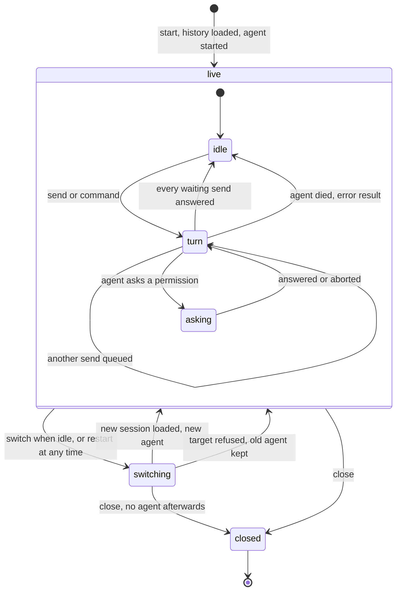
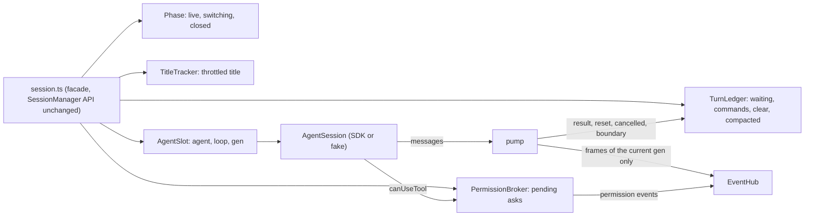

# M7 Architecture Hardening Implementation Plan

> **For agentic workers:** REQUIRED SUB-SKILL: Use superpowers:subagent-driven-development (recommended) or superpowers:executing-plans to implement this plan task-by-task. Steps use checkbox (`- [ ]`) syntax for tracking.

**Goal:** Act on the user's architecture review of 2026-10-27 (`docs/architecture.md` §8–9). The milestone has a warm-up task and five packages, executed in document order:
- **M7-01 — diagram tab:** a rendered diagram opens full size in an app tab.
- **A — web structure:** UI persistence moves to listener middleware; three large components are split by composition.
- **E — agent protocol:** our own `AgentEvent` stream (ACP-like) between the agent adapter and everything else; the SDK stays inside the Claude adapter.
- **B — session state machine:** `SessionManager` gets explicit states and small single-purpose parts.
- **C — history after compaction:** the replay starts at the last compaction. «Показать до сжатия» loads the earlier part on demand.
- **D — one tab per window:** a second tab sees «Окно уже открыто в другой вкладке» and can take over («Работать здесь»).

**Architecture:**
- E changes the wire format (`{kind:'agent'}` replaces `{kind:'sdk'}`) but not what the user sees.
- A and B change no behaviour. They are proved by the existing tests plus new characterization tests written first.
- C and D add protocol version 5:
  - `replay.earlier`, `GET /history` (C);
  - `occupied`, `taken-over`, the client message `takeover` and close code 4001 (D).
- Both sit on the new session parts from B.

**Tech Stack:** Node ≥ 23.6 TS (server, `ws`), React 19 + Redux Toolkit 2 (web), vitest, Playwright.

**Spec:** `docs/architecture.md` §8 (the risks) and §9 (the user's rulings). The user's words, 2026-10-27:
- on §8.2: "надо править, делать полноценную систему, иначе всё поедет и полезет туча багов";
- on §8.4: "ограничил бы использование тулы в нескольких вкладках для одной сессии … приложение должно сказать, что уже открыта другая вкладка";
- on §8.5: "сделал бы это сразу после компакта";
- on §8.6: "лучше сразу делать композицию".

- on §8.1: "развёл бы agent sdk и client/server API protocol … если мы захотим подключить других агентов (GPT, GLM, DeepSeek), то на сервере нужно будет писать адаптеры";
- on full-size diagrams: "было бы здорово открывать эту диаграмму в новой табе в полном масштабе" (an app tab, confirmed).

The takeover and «Показать до сжатия» designs were proposed in chat and accepted ("Огонь"); so were package E before B and the diagram tab.

**Base:** worktree `~/Documents/Projects/nota-bene-m7`, branch `m7-architecture` from `main`.

## Global Constraints

The M0–M6 rules hold:
- one task is one small commit with the trailer `Task: M7-NN`;
- every UI string goes through `t()` in ru and en;
- tests use ports 4790–4795 only;
- the smoke follows the CLAUDE.md hygiene;
- persistence code (C) gets an independent reviewer;
- check test exit codes directly, never through a pipe into grep.

Behaviour rules:
- **A and B are pure refactors.** No test may change except imports and paths. A test that has to change in meaning is a finding, not a fix.
- **The `SessionManager` type** (`server/src/session.ts`) and its use in `server/src/server.ts` stay as they are through B. C and D may add members.
- **The user works in the app.** A web change reaches them after `npm run build -w web` and a reload. A server change needs "Restart the server" after the CLAUDE.md pre-check.

**Rulings:**

**History (C)**
- **R-M7-1. The SDK cannot give back the conversation before a compaction.** Checked 2026-10-27 on a real transcript: 6 `compact_boundary` entries in the file, yet `getSessionMessages` returned 90 messages starting from the compaction summary, and no option of SDK 0.3.310 returns more. So the earlier part is kept by us:
  - at each `compact_boundary` the server cuts the hub history before the boundary;
  - it appends the cut part as one segment to its own archive, `~/.nota-bene/history/<sessionId>.jsonl`, one JSON line per segment: `{"segment":n,"events":[…]}`;
  - `stream_event` frames are dropped from the archive, because a replay never needs them (the transcript replay has none either).
- Reading the CLI's `.jsonl` directly is rejected. It is a private format, the same risk as §8.1.
- Consequence: compactions done outside Nota Bene (the plain CLI) have no archive, and the button is not shown for them.
- **R-M7-2. The cut keeps the `compact_boundary` frame itself**, so the "compacted" marker stays the first item. The `/compact` user event before it goes to the archive.
- **R-M7-3. `/clear` starts a new conversation id:** the replay has `earlier: false`. The old id's archive stays on disk; switching back to that session offers it again.
- **R-M7-4. «Показать до сжатия» loads one segment per click,** newest first: `GET /history?session=<id>&before=<n>` → `{events, segment, more}`.
  - **Before it is loaded,** a sent comment whose message is in an unloaded segment is labelled `srcBeforeCompact` in its card. It is not labelled "orphan", and it has no jump.
  - **After it is loaded,** the highlight resolves as usual.

**One tab (D)**
- **R-M7-5. The server decides.** The first socket is the owner. A later socket gets `{kind:'occupied'}` plus `hello`: no replay and no state frames, and its messages other than `takeover` are ignored.
  - On `takeover`, the server sends the owner `{kind:'taken-over'}`, closes it with code 4001, then attaches the new socket as on a normal connect (replay, state frames, `hello`).
- **R-M7-6. Reload race.** When a socket arrives while an owner exists, the server waits up to `TAKEOVER_GRACE_MS = 700` for the owner to close before answering `occupied`. A reloading tab's old socket closes within that time in practice.
- **R-M7-7. Zombie owner (sleep, dead network).** The server pings the owner every `HEARTBEAT_MS = 30_000` and terminates it when the previous ping got no pong. «Работать здесь» works regardless.
- **R-M7-8. The client stops reconnecting on close code 4001.**
  - The taken-over tab shows «Открыто в другой вкладке» and a «Работать здесь» button. The button reconnects and sends `takeover` once `occupied` arrives.
  - The occupied tab shows «Окно уже открыто в другой вкладке» and the same button.
  - Both are one full-window overlay component; under it the app stays mounted but inert.
- **R-M7-9. Tests.** `startServer` gets `oneTab?: boolean`, default `true`; `main.ts` uses the default.
  - Server unit tests that check broadcasting to several sockets pass `oneTab: false`.
  - The e2e tests that open a second page (`e2e/comments.spec.ts:239`, `e2e/controls.spec.ts:106`, `:339`) become takeover flows or are rewritten to one page. Any assertion they lose is listed in the task report.
- **R-M7-10. A protocol-4 page (a cached old bundle) against a new server** would show an empty app on `occupied`. This is accepted, because a reload fixes it.

**State machine (B)**
- **R-M7-11. The parts and their owners**, all under `server/src/session/`; `session.ts` stays the façade that wires them:

| Part | File | Owns today's |
|---|---|---|
| `Phase` | `phase.ts` | `switching`, `closed` |
| `TurnLedger` | `turns.ts` | `waiting`, `commandIds`, `clearSent`, `clearResultDue`, `compactedInTurn` |
| `PermissionBroker` | `permissions.ts` | `pending`, `askFor` |
| `TitleTracker` | `title.ts` | `title`, `titleAt`, `titleTimer`, `fetchTitle`, `scheduleTitle` |
| `AgentSlot` | `agentSlot.ts` | `agent`, `loop`, `gen`, `ensureAgent`, teardown |

  `forkPending`, `sessionId`, `root`, `mode` and `model` stay in the façade.

**Diagrams (B)** — the states the parts implement; `busy()` is true in `turn`, `asking` and `switching`.





**Diagram tab (M7-01)**
- **R-M7-12.** Every rendered diagram (mermaid or svg block, in the chat, md files and comments) shows a ⤢ button on hover. It opens one app tab per diagram, of kind `diagram`, holding the source text, the language and a title. The title is the first line of the source, up to 40 characters.
  - The tab id is `diagram:<8 hex of sha1(source)>`, so the same diagram opened twice reuses its tab.
  - The view fits the diagram to the pane. Wheel or pinch zooms around the cursor (0.25×–8×), drag pans, a click toggles fit / 100%, and `0` resets.
  - The tab is persisted with the file tabs (source included) and re-rendered after a reload.

**Agent protocol (E)**
- **R-M7-13. The boundary.** `AgentSession.messages` yields `AgentEvent` (in `shared/src/agent.ts`), not `SDKMessage`. The SDK is imported only under `server/src/agent/claude/`. The fake backend emits SDK frames through the same Claude mapper, so e2e scripts and `real-frames.json` keep testing the real shapes.
- **R-M7-14. The event set**, named after ACP's session updates so an ACP adapter is a thin mapping later. Exact:

```ts
export type StopReason = 'done' | 'interrupted' | 'failed';
export type AgentEvent =
  | { t: 'message-start' }                                   // a streamed text block opens (ACP agent_message_chunk, first)
  | { t: 'message-chunk'; text: string }                     // ACP agent_message_chunk
  | { t: 'message'; id: string; text: string }               // the final text of a block; id `${uuid}:${index}`
  | { t: 'tool-call'; id: string; name: string; input: Record<string, unknown>; sub: boolean } // ACP tool_call
  | { t: 'tool-update'; id: string; text: string; isError: boolean }                          // ACP tool_call_update
  | { t: 'turn-end'; stop: StopReason; secs: number; error?: string; answers: string[] | 'all' | 'none'; queued: number }
  | { t: 'cancelled'; sendId: string }
  | { t: 'compacting' } | { t: 'compact-failed'; error?: string } | { t: 'compacted'; preTokens: number; ms?: number }
  | { t: 'reset'; newId?: string }                           // /clear: a new conversation
  | { t: 'init'; sessionId?: string; model?: string; mode?: Mode }    // server-internal: never sent to clients
  | { t: 'mode'; mode: Mode }                                // ACP current_mode_update
  | { t: 'task'; id: string; phase: 'started' | 'progress' | 'updated' | 'done'; desc?: string; type?: string; tokens?: number; tool?: string; summary?: string }
  | { t: 'suggestion'; text: string }
  | { t: 'rate-limit'; info: unknown };                      // server-internal (stats)
```

  The wire event is `{ kind: 'agent'; e: AgentEvent; ts: number }`, replacing `{ kind: 'sdk' }`; `init` and `rate-limit` are never emitted to clients. The web keeps `forcePending`: a `turn-end` with `stop: 'done'` while a forced send is pending still shows as interrupted.
- **R-M7-15. Capabilities.** `AgentBackend.capabilities` is `{ compact: boolean; clear: boolean; modes: Mode[]; usage: boolean; fileSuggestions: boolean; fork: boolean; idleCompact: boolean }`, sent in `hello`. The UI hides a control whose capability is false. Claude has all of them true; the fake mirrors Claude unless its script says otherwise.
- **R-M7-16. Other models and agents (not in M7).** Other models on the same agent (DeepSeek's Anthropic-compatible endpoint, likely GLM) need no adapter: they are a per-window `ANTHROPIC_BASE_URL` setting, a later task. Other agents (Codex, Gemini CLI, OpenCode) come later through one ACP adapter. Adapters to bare model APIs are rejected: they would mean writing our own agent loop.

**Turn state (B)**
- **R-M7-17. The global activity is derived; each send is strict.** `idle`, `turn` and `asking` are not stored states; `activity()` derives them from `TurnLedger` and `PermissionBroker`.
  - Why: turns really overlap. Several sends can be queued, a forced send can interrupt a running one, and sub-agents can ask several permissions at once. A single stored state would need the counters anyway, and two copies of the truth drift apart, which is the class of bug this milestone removes.
  - The strictness moves to the entities. Each send in `TurnLedger` has its own state, `queued → running → answered | cancelled | failed`, and an illegal step throws: for example, answering a send twice, or running a cancelled one.
  - Exception: a `turn-end` naming an id the ledger never saw (the CLI's synthetic turns, a send from before a restart) is ignored, not thrown. This matches today's behaviour.
  - Each `PermissionBroker` ask is `open → answered | aborted`.
  - The global `Phase` stays strict, because it is truly exclusive.

## Review Focus

1. **The owning tab is reloaded.** It must come back as the owner, without the occupied overlay flashing. Test in M7-15: e2e reloads the page twice and expects no overlay.
2. **A compaction lands in the middle of a live turn** (auto-compact while the agent works, idle compaction). Frames after the boundary stay in the replay, and `busy` and `waiting` are unaffected. Test in M7-12.
3. **A sent comment on a message that went into the archive** must not read as orphaned or deleted. Test in M7-13.
4. **A takeover while a switch or a turn runs.** Ownership is independent of the session: the new tab gets the current replay and the `switching` and busy state. Test in M7-14: a takeover during a fake turn shows the turn running.
5. **Server restart after a compaction.** The replay comes from the transcript (post-compaction), and `earlier` is true when the archive has segments for that id. Test in M7-12.

---

## M7-01: Diagram tab (R-M7-12)

**Files:**
- Modify: `web/src/tabs/slice.ts` (a `DiagramTab` kind and `openDiagram({source, lang})`; persisted in `SavedTabs`), `web/src/tabs/Panes.tsx`, `web/src/tabs/TabStrip.tsx` (icon), `web/src/feed/Markdown.tsx` (the ⤢ button on `.mermaid-out` / `.svg-out`)
- Create: `web/src/diagram/DiagramView.tsx` (render through the same mermaid loader and DOMPurify path as `Markdown.tsx`, then fit, zoom and pan), `web/src/diagram/zoom.ts` (pure: fit scale, zoom around a point, clamps)
- i18n: `openDiagram` «Открыть диаграмму» / "Open diagram", `diagramTab` «Диаграмма» / "Diagram"
- Test: `zoom.test.ts` (fit, clamp 0.25–8, the point under the cursor stays put), `DiagramView.test.tsx`, a slice test (the same source reuses its tab; a reload restores it), and an e2e step in `e2e/chat.spec.ts` (⤢ opens the tab and the svg is visible)

Steps:
- [ ] Red, then green.
- [ ] `npm test` and `npm run e2e` exit 0.
- [ ] Commit `feat(web): open a diagram full size in its own tab` with `Task: M7-01`.

## Package A — web structure

### M7-02: UI persistence on listener middleware (§8.3)

**Files:**
- Create: `web/src/store/persist.ts`
- Modify: `web/src/store/store.ts` (remove the `store.subscribe` block)
- Test: existing `web/src/store/*.test.ts*`, `web/src/tabs/*.test.ts*`, `web/src/files/RecentFiles.test.tsx` (unchanged)

**Interfaces:**
- Produces: `persistListeners(lm: ListenerMiddlewareInstance<RootState>): void`, registered in `makeStore` on its own listener middleware (prepended next to `controlsListener`).

One listener per concern, each with a `predicate` comparing `original` against current state:
- `panel:comments`;
- `panel:tree`;
- `tree:<root>[:<src>]` dirs;
- `tabs:<root>`;
- the recent-file dwell (`RECENT_DWELL_MS`, cancelled by the next active change through `cancelActiveListeners`);
- the root change: on `serverEvent` with `kind:'session'` and a root different from `tabs.root`, call `clearRefCache` (not on the first root), `loadSources(!first)`, then dispatch `enterRoot` with the saved tabs and dirs read before the dispatch.

- [ ] Write `persist.ts` and remove the subscriber; there must be no `store.subscribe` left in `store.ts`.
- [ ] `npm test -w web` — all pass, with no test file edited.
- [ ] `npx tsc -b` — exit 0.
- [ ] Commit `refactor(web): UI persistence as listener middleware` with `Task: M7-02`.

### M7-03: FileTree by composition (§8.6)

**Files:**
- Create: `web/src/files/tree/useTreeEntries.ts` (entries, loading, failed, `track`, merged `refresh`, `missedTurn`, `shownIn`)
- Create: `web/src/files/tree/useExpandAll.ts` (BFS, `EXPAND_CAP`, `EXPAND_FETCHES`, `NO_EXPAND`)
- Create: `web/src/files/tree/TreeHeader.tsx`, `web/src/files/tree/TreeRow.tsx`
- Modify: `web/src/files/FileTree.tsx` (composition only)

**Interfaces:**
- Produces: `FileTree` and `EXPAND_CAP` keep their exports and paths (`EXPAND_CAP` re-exported).
- Limit: no file over 200 lines.

- [ ] Move code, no logic edits.
- [ ] `npm test -w web` and `npx tsc -b` pass, with no test file edited.
- [ ] Commit with `Task: M7-03`.

### M7-04: FileView by composition (§8.6)

**Files:**
- Create: `web/src/files/view/useFileLoad.ts` (the HEAD / Range probe / GET sequence, `rev`, `bust`, `failed`, `reloadMedia`, version dispatch)
- Create: `web/src/files/view/useMediaMarkup.ts` (`markable`, `markPopup`, `onMarkAdd`, `markAdded`, `saving`)
- Create: `web/src/files/view/CodeText.tsx`, `TextBody.tsx`, `MediaBody.tsx`
- Modify: `web/src/files/FileView.tsx`

Same rules as M7-03: exports stay, files ≤ 200 lines, no test edited. Commit with `Task: M7-04`.

### M7-05: CommentCard by composition (§8.6)

**Files:**
- Create: `web/src/comments/card/useCommentSource.ts` (`sourceState`, orphan detection, `itemRoot`/`fileRoot`)
- Create: `web/src/comments/card/CardActions.tsx` (`IconButton` and the action row)
- Create: `web/src/comments/card/CommentCardPopover.tsx` (with `usePopoverPlacement`)
- Modify: `web/src/comments/CommentCard.tsx`

Same rules as M7-03: exports stay, files ≤ 200 lines, no test edited. Commit with `Task: M7-05`.

## Package E — agent protocol (R-M7-13…15)

Between M7-07 and M7-08 the branch's e2e is red, because the server speaks the new protocol before the web does. Unit tests stay green per task. M7-08 restores e2e.

### M7-06: `AgentEvent` and the Claude mapper

**Files:**
- Create: `shared/src/agent.ts` (R-M7-14 verbatim, exported from the package)
- Create: `server/src/agent/claude/map.ts` with `mapSdk(m: SDKMessage): AgentEvent[]` (pure; one SDK frame gives zero or more events) and `server/src/agent/claude/map.test.ts`
- Move: `server/src/agent/sdk.ts` → `server/src/agent/claude/sdk.ts`, `server/src/agent/transcript.ts` → `server/src/agent/claude/transcript.ts` (imports updated, behaviour unchanged)

The mapping follows today's `web/src/store/feed.ts` `reduceSdk`, `web/src/tasks/slice.ts`, the suggestion in `web/src/controls/slice.ts`, and what `server/src/session.ts` `pump` and `server/src/stats.ts` `onSdk` read. Every frame type in `server/test/fixtures/real-frames.json` gets a test. The `turn-end` mapping:
- `stop` is `interrupted` when `terminal_reason` starts with `aborted`, or for `error_during_execution` without `is_error`;
- otherwise `stop` is `failed` when `is_error`, or for a non-success subtype;
- `error` comes from `result` or `errors[]`;
- `answers` is the `user_message_uuids` (or `user_message_uuid`) array, else `'all'` when `is_error`, else `'none'`;
- `queued` is `queued_turn_count ?? 0`.

- [ ] Red, then green; `npx tsc -b` exit 0. Commit with `Task: M7-06`.

### M7-07: The server on `AgentEvent`

**Files:**
- Modify: `server/src/agent/types.ts` (`messages: AsyncIterable<AgentEvent>`; `history()` returns `ServerEvent[]` built from `AgentEvent`; `capabilities`), `server/src/agent/claude/sdk.ts` (maps with `mapSdk`), `server/src/agent/claude/transcript.ts` (emits `message`, `tool-call`, `tool-update`, `user`), `server/src/agent/fake.ts` (its SDK frames pass through `mapSdk`), `server/src/session.ts` (`pump` reads `AgentEvent`; emits `{kind:'agent'}`; `init` and `rate-limit` are not emitted), `server/src/stats.ts` (`onAgent(e)`), `shared/src/protocol.ts` (`{kind:'agent'}` replaces `{kind:'sdk'}`, `PROTOCOL = 5`), and the server tests that assert `kind:'sdk'` frames
- Rule: `grep -rn "claude-agent-sdk" server/src` lists only files under `server/src/agent/claude/`.

- [ ] Full server tests exit 0 (`npx vitest run server`); `npx tsc -b` exit 0. Commit with `Task: M7-07`.

### M7-08: The web on `AgentEvent`

**Files:**
- Modify: `web/src/store/feed.ts` (`reduceAgent` replaces `reduceSdk`; the loose `Sdk` type is removed), `web/src/tasks/slice.ts`, `web/src/controls/slice.ts`, `web/src/store/store.ts` (`compactTimingMiddleware` reads `compacted.ms`), and the web tests' frames (rewritten as `AgentEvent`s; each rewritten test keeps its assertion)

- [ ] `npm test` and `npm run e2e` exit 0, with e2e green again. Commit with `Task: M7-08`.

### M7-09: Capabilities (R-M7-15)

**Files:**
- Modify: `shared/src/protocol.ts` (`hello.capabilities`), `server/src/server.ts`, the agent backends, `web/src/controls/*` (Compact/Clear, ModePill, idle toggle), `web/src/stats/Meters.tsx` (usage), `web/src/composer/MentionPicker.tsx` (fileSuggestions only changes the source, the own index stays), `web/src/controls/SessionPicker.tsx` (fork)
- Test: a fake script with `"capabilities": {"compact": false, "modes": ["default"]}` hides Compact and the mode pill (unit and one e2e).

- [ ] Red, then green; `npm test` and `npm run e2e` exit 0. Commit with `Task: M7-09`.

## Package B — session state machine

### M7-10: Characterization tests for SessionManager

**Files:**
- Create: `server/src/session.characterization.test.ts`

Write one test per scenario below that is not already pinned by `session.test.ts`, `switch.test.ts` or `commands.test.ts`. The report lists, per scenario, the existing test name or the new one. All against the fake backend and today's code, so they pass before any refactor:
1. A send during a switch returns `'switching'`; nothing is emitted.
2. A switch while a send waits is refused with `SwitchError('switch')`; a restart while it waits interrupts, then resumes the same id.
3. A permission asked by the old agent after `gen++` resolves `false` and is never emitted.
4. `/clear`: the reset empties the hub; the following result is not stored; the new id is saved; the id listeners get `(new, old)`.
5. A `/compact` result never arms idle compaction; a normal turn's result does; a turn containing `compact_boundary` does not.
6. `command_lifecycle` `cancelled` drops that id from `waiting`.
7. The agent's loop ends without close → an error result answers every waiting send; `busy()` is false after it.
8. A fork: the source id is never written to `sessions.json` before the first init names the new id; a restart before that init keeps forking.
9. `setMode` during a switch answers with the current mode and its ack; it does not apply.
10. `close()` during a switch: no agent is started afterwards.
11. A forced send interrupts first, then sends with priority `'now'`; two sends keep their order.
12. A title lookup that answers after a switch is dropped.

- [ ] Write the tests and run `npx vitest run server/src/session.characterization.test.ts` — all pass on the unchanged code.
- [ ] Commit `test(server): characterize SessionManager before the state machine` with `Task: M7-10`.

### M7-11: Explicit state machine (R-M7-11, R-M7-17, §8.2)

**Files:**
- Create: `server/src/session/phase.ts`, `turns.ts`, `permissions.ts`, `title.ts`, `agentSlot.ts`, each with its own `*.test.ts`
- Modify: `server/src/session.ts` (the façade)

**Interfaces** (exact; later tasks use them):

```ts
// phase.ts
export type PhaseKind = 'live' | 'switching' | 'closed';
export class Phase {
  get kind(): PhaseKind;
  /** live → switching; throws SwitchError('switch', 'a switch is already in progress') when switching; no-op returning false when closed */
  beginSwitch(): boolean;
  /** switching → live (or stays closed) */
  endSwitch(): void;
  /** any → closed; final */
  close(): void;
}
// turns.ts
export type SendState = 'queued' | 'running' | 'answered' | 'cancelled' | 'failed';
export class TurnLedger {
  /** a new send: queued; throws when the id is known */
  sent(id: string, o?: { command?: 'compact' | 'clear' }): void;
  /** queued → running (handed to the agent); throws from any other state */
  running(id: string): void;
  state(id: string): SendState | undefined;
  /** applies a result frame: `store` false for a /clear's own result, `arm` whether idle compaction should arm */
  turnEnd(e: Extract<AgentEvent, { t: 'turn-end' }>): { store: boolean; arm: boolean };
  cancelled(id: string): void;
  compactBoundary(): void;
  /** a conversation_reset: clears waiting; the next result is a /clear's own when a /clear was sent */
  reset(): void;
  /** a real user send follows: the next result is a normal one */
  userTurn(): void;
  waiting(): number;
  clear(): void;
}
// permissions.ts
export class PermissionBroker {
  constructor(o: { emit: (ev: EmitInput) => void });
  ask(gen: () => number, g: number): PermissionAsk;
  answer(id: string, allow: boolean): void;
  pending(): number;
  denyAll(): void;
}
// title.ts
export class TitleTracker {
  constructor(o: { lookup: (id: string, dir: string) => Promise<string | null | undefined>; onChange: () => void });
  get title(): string | null;
  afterResult(id: string, dir: string, gen: number, currentGen: () => number): void;
  load(id: string, dir: string): Promise<void>;
  reset(): void;
  stop(): void;
}
// agentSlot.ts
export class AgentSlot {
  constructor(o: { start: (g: number) => AgentSession; pump: (a: AgentSession, g: number) => Promise<void> });
  get gen(): number;
  get agent(): AgentSession | null;
  isCurrent(a: AgentSession, g: number): boolean;
  /** throws when the phase is not live */
  ensure(phaseLive: boolean): AgentSession;
  /** gen++, close the agent, wait for its loop up to `waitMs` */
  teardown(waitMs: number): Promise<void>;
  died(a: AgentSession): void;
}
```

`activity(): 'idle' | 'turn' | 'asking'` is derived (R-M7-17). `busy()` becomes `phase.kind === 'switching' || turns.waiting() > 0 || permissions.pending() > 0`. An illegal transition throws, and it is a test failure, never caught silently.

- [ ] Write each part with its unit test first (red), then the part (green).
- [ ] Rewire `session.ts` onto the parts; `session.ts` ≤ 350 lines.
- [ ] Full `npm test` (exit 0); M7-10's file unchanged and green; `npx tsc -b` exit 0.
- [ ] Independent review on the most capable model: the diff, plus the M7-10 scenarios mapped to the new code.
- [ ] Commit with `Task: M7-11`.

## Package C — history after compaction

### M7-12: Server archive and `/history` (R-M7-1…4)

**Files:**
- Create: `server/src/archive.ts`, `server/src/archive.test.ts`
- Modify: `server/src/hub.ts` (`cut(index)`), `server/src/session.ts` (at `compact_boundary`), `server/src/server.ts` (route), `shared/src/protocol.ts` (`PROTOCOL = 5`, `replay.earlier?: number`), `server/src/system.ts` (storage size of `history/`; the clean action removes archives whose transcript is gone)

**Interfaces:**
- `EventHub.cut(): ServerEvent[]` removes and returns the history before the last stored `compacted` agent event (the event stays).
- `EventHub.reset(events, o?: { earlier?: number })` and the connect replay carry `earlier` (the number of archived segments) when > 0.
- `HistoryArchive({ dir })`, with these methods:
  - `append(sessionId, events): number` — returns the new segment number, starting at 1; drops `message-start` and `message-chunk` events; one fsync'd line per segment;
  - `count(sessionId): number`;
  - `segment(sessionId, n): ServerEvent[] | null`.
  - Ids are checked against the session-id pattern; a corrupt line is skipped and reported once.
- `GET /history?session=<id>&before=<n>` → `200 {events, segment, more}` for segment `n-1`.
  - 404 when there is none.
  - 409 when `session` is not the current id; only the current session's archive is served.

Tests (named):
- `cut keeps the boundary and later frames`;
- `a compaction mid-turn keeps waiting and busy`;
- `stream_event frames are not archived`;
- `restart after a compaction replays the transcript with earlier = count`;
- `/clear replays with no earlier`;
- `history 409 for another session`;
- `corrupt archive line is skipped`.

Steps:
- [ ] Red, green, full `npm test` exit 0, `npx tsc -b` exit 0.
- [ ] Independent review (persistence).
- [ ] Commit with `Task: M7-12`.

### M7-13: «Показать до сжатия» in the feed (R-M7-4)

**Files:**
- Modify: `web/src/store/feed.ts` (`earlier: number` in `FeedState`, set from `replay.earlier`; action `historyPrepended({events, segment, more})` reduces `events` from `emptyFeed` and prepends the items)
- Create: `web/src/feed/EarlierButton.tsx` (first item of the feed when `earlier > 0`; loading and error states; strings `earlierShow` «Показать до сжатия» / "Show before compaction", `earlierLoading`, `earlierFailed`, `srcBeforeCompact` «до сжатия» / "before compaction")
- Modify: `web/src/comments/card/useCommentSource.ts` (a sent comment whose message is absent while `earlier > 0` → `srcBeforeCompact`, no jump)
- Test: `feed.test.ts` (`historyPrepended keeps live state`), `EarlierButton.test.tsx`, a card test for `srcBeforeCompact`

Steps:
- [ ] Red, green.
- [ ] `npm test -w web` exit 0.
- [ ] Commit with `Task: M7-13`.

## Package D — one tab per window

### M7-14: Server ownership and takeover (R-M7-5…7, R-M7-9)

**Files:**
- Modify: `server/src/server.ts` (owner, grace, heartbeat, `takeover`), `shared/src/protocol.ts` (`occupied`, `taken-over`, `takeover`), `server/src/hub.ts` only if needed
- Modify: server tests that need several sockets (`oneTab: false`)
- Create: `server/src/onetab.test.ts`

Tests (named):
- `second socket gets occupied and no replay`;
- `occupied socket's send is ignored`;
- `takeover closes the owner with 4001 and replays to the new one`;
- `owner closing within the grace makes the newcomer the owner`;
- `owner with no pong is terminated`;
- `takeover during a turn shows the turn running`;
- `/info.clients counts the owner only`.

Steps:
- [ ] Red, green, full `npm test` exit 0.
- [ ] Commit with `Task: M7-14`.

### M7-15: Occupied and taken-over screens (R-M7-8)

**Files:**
- Modify: `web/src/net/socket.ts` (no reconnect after 4001; `reconnect()` export)
- Modify: `web/src/store/store.ts` (`ConnState` gains `'occupied' | 'taken'`; thunk `takeOver()`)
- Create: `web/src/shell/OneTab.tsx` (full-window overlay; strings `occupiedTitle` «Окно уже открыто в другой вкладке», `takenTitle` «Открыто в другой вкладке», `workHere` «Работать здесь», en equivalents)
- Modify: the e2e specs named in R-M7-9
- Create: `e2e/onetab.spec.ts` (second page sees the overlay; «Работать здесь» moves the session; the first page shows taken; a double reload of the owner shows no overlay)

Steps:
- [ ] Red, green.
- [ ] `npm test` and `npm run e2e` exit 0.
- [ ] Commit with `Task: M7-15`.

### M7-16: Final review, merge and smoke

- [ ] Whole-branch review on the most capable model.
- [ ] Fix the findings; scoped re-review.
- [ ] Fast-forward `main`; `npm run build -w web`.
- [ ] Pre-check per CLAUDE.md, then ask the user for "Restart the server" and verify the pid changed.
- [ ] Smoke with the user:
  - a second tab and «Работать здесь»;
  - a reload of the owner;
  - `/compact`, then a reload, then «Показать до сжатия»;
  - a server restart after a compaction.
- [ ] Update `docs/architecture.md` §3–§5 and §8 to the new state; update `CLAUDE.md` (state dir `history/`, the `/history` route, one tab per window).
