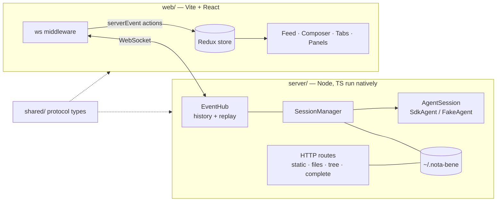

# Nota Bene rebuild — design

Status: draft for review · 2026-10-24
Source of truth for features: `prototype/` (working spike) and the session journal it was built in.

## Goal

Rebuild the prototype as a maintainable React + TypeScript app with feature parity. Then switch daily use over to it and retire `prototype/`. Parity means everything listed in [Parity checklist](#parity-checklist) works at least as well as in the prototype. No new features until parity, with three exceptions that fix the prototype's structural problems: stable comment anchors, in-process session switching and a state directory outside the repo.

## Non-goals (until parity)

- Annotations on media (timecodes, image regions).
- Multi-user, auth, remote access. The server binds to `127.0.0.1` only.
- Desktop packaging (Electron/Tauri). The app runs in the user's Chrome.
- Replacing the Claude Code CLI. The agent stays the CLI, driven through the Agent SDK.

## Architecture



- **npm workspaces**, three packages: `shared/` (protocol types and pure helpers), `server/`, `web/`.
- **The server runs TypeScript natively** (Node ≥ 23.6 strips types; this machine has 26.6). That means no server build step and `erasableSyntaxOnly: true` (no enums, namespaces or parameter properties).
- **web**: Vite, React, Tailwind 4, shadcn/ui, Redux Toolkit + react-redux. Markdown stays on marked + DOMPurify + highlight.js + mermaid (proven in the prototype), wrapped in one memoised `<Markdown>` component.
- **State management: Redux Toolkit.**
  - Every server event enters the store as one action, `serverEvent(ev)`, and the slices are pure reducers over it. The app is event-sourced by nature, so this fits directly.
  - Redux DevTools gives a replayable log of exactly what the server sent, which is the main debugging need: streaming, replay and mid-turn races.
  - Slices: `feed`, `conn`, then `comments` (M1), `tabs` (M2), `session`/`stats`/`mode` (M3).
  - The WebSocket lives in a middleware: inbound frames are dispatched as `serverEvent`, and outbound messages are thunks.
  - Components read only through typed selectors and never touch the socket.
- **`AgentSession` interface** between the server and the SDK. There are two implementations:
  - `SdkAgent` wraps `query()`;
  - `FakeAgent` replays scripted events. It powers every automated test: deterministic, no tokens.
- **`SessionManager`** owns the current `AgentSession`. Switching session or folder is `close()` plus a new session in the same process. There is no exit-75 restart: a restart is needed only when the server's own code changes.

## State directory

`~/.nota-bene/` (override with `NOTA_BENE_HOME`). The repo stays clean and publishable.

| File | Content |
|---|---|
| `sessions.json` | last session id per project dir |
| `windows.json` | running servers: `{port, pid, root, startedAt}`; stale entries are pruned by pid check |
| `comments/<sessionId>.json` | pending and sent comments of a session (see anchors) |
| `prefs.json` | permission mode per project dir, UI language |

`windows.json` replaces probing ports over HTTP. That probing raced with restarts and could open a second window on the same folder.

## Comment anchors (the key decision)

The prototype keeps live DOM `Range`s. React re-renders replace text nodes, so those ranges would silently break, and comments are lost on reload. Comments are therefore stored as **text anchors**, modelled on the W3C Web Annotation selectors (TextPosition + TextQuote):

```ts
type AnchorSource =
  | { kind: 'message'; id: string }   // stable id, see below
  | { kind: 'file'; path: string };
type Anchor = {
  source: AnchorSource;
  start: number; end: number;         // offsets in the source's rendered text
  quote: string;                      // exact selected text
  prefix: string; suffix: string;     // up to 32 chars of context each side
};
```

- **Rendered text** is the source container's text content with whitespace normalised. The `textOf(root)` and `rangeFromOffsets(root, start, end)` pair lives in `web/src/anchors/` and is the only code that touches DOM ranges.
- **Resolving an anchor:**
  1. take the slice at `start..end`; if it equals `quote`, done;
  2. otherwise search for `quote`, scoring the hits by `prefix`/`suffix` match;
  3. otherwise the comment is *orphaned*: it stays in the panel with its quote, but nothing is highlighted.
- **Stable message ids:**
  - user messages get a client-generated `uuid`, sent as `SDKUserMessage.uuid`, which the transcript keeps;
  - an assistant text block's id is `${assistant.uuid}:${blockIndex}`;
  - a block that is still streaming cannot be commented on until it is final.
- **Persistence.** The server stores comments in `comments/<sessionId>.json`. They survive reloads, restarts and resumes, and sent comments keep their dimmed marks.

## Protocol

All messages are JSON over one WebSocket. The types live in `shared/src/protocol.ts`, and SDK message types are imported from the SDK package rather than redefined.

- **Server → client:**
  - `replay {events}` — sent on connect;
  - `sdk {m}`;
  - `user {id, text, comments, images}`;
  - `permission {id, toolName, input}` and `permission-done {id, allow}`;
  - `stats {...}`;
  - `mode {mode}`;
  - `session {id, root, title}`;
  - `server-error {where, message}`.
- **Client → server:**
  - `send {id, text, comments, images, force}`;
  - `interrupt`;
  - `permission {id, allow}`;
  - `command {name: 'clear'|'compact'}`;
  - `mode {mode}`;
  - `switch {sessionId|null, dir}`;
  - `comments {sessionId, items}`.
- Every inbound message is validated by `parseClientMessage()`. Invalid input becomes a `server-error`, never a crash.

## Error policy (from the prototype, made structural)

- Every HTTP route runs inside one wrapper: a thrown error returns 500 with the message and a `server-error` toast.
- `uncaughtException` and `unhandledRejection` are reported, not fatal.
- File streams handle `error` events.
- Range parsing follows RFC 9110. A range that cannot be satisfied returns 416, never a throw. This was the prototype's crash.

## Parity checklist

The milestone that delivers each item is in brackets. "Verify" lists what the e2e or manual check must show.

**Chat (M0)**
- [ ] Streaming markdown replies; code highlighting; mermaid and svg blocks rendered — verify: fake agent's markdown fixture renders headings, code and a mermaid diagram.
- [ ] Messages sent while the agent works are injected mid-turn (`priority: 'next'`); ⌘Enter interrupts and sends (`'now'`); Stop button and Esc interrupt.
- [ ] Tool lines (`▸ Tool · arg`), subagent tool lines indented, errored tool lines red.
- [ ] Done line with duration and time; interrupted turns marked.
- [ ] Permission cards (allow / deny) — moved into M0 from M3: without them the real agent stalls on its first prompt.
- [ ] Transcript replay on reconnect and on resume (`getSessionMessages`); user images in replay come with attachments in M2.
- [ ] i18n ru/en, auto from the browser language, toggle in the header (every string through `t()` from day one).
- [ ] Plannotator palette and chrome: header, tab pills, paper card over a grid, footer.

**Comments (M1)**
- [ ] Select text in a reply, your own message or an open file → "Comment" button → popup; ⌘/Ctrl+Enter adds the comment, Esc cancels.
- [ ] Pending marks are yellow and rounded; sent marks are dimmed purple; click on a mark → the same card in a popup; edit and delete.
- [ ] Side panel stack: cards with edit (✓/✕, ⌘Enter/Esc, ? help) and delete; jump to source; count badges on tabs and tree rows.
- [ ] Batch send: one message of fragments plus comments plus image references.
- [ ] Anchors persist across reloads and resumes; orphaned comments are shown, not dropped.

**Files & media (M2)**
- [ ] File tree sheet (overlay, collapsible, filter, ↻ refresh keeping the open folders, auto-refresh after each live turn).
- [ ] File tabs: md (rendered, commentable), code (highlighted), image, video, audio; HTTP Range seeking.
- [ ] A playing video goes to picture-in-picture when its tab is left; audio keeps playing; ▶ dot on the tab; closing the tab stops it.
- [ ] Clickable project paths in `code` and relative links (HEAD check, strike-through if missing).
- [ ] `@` mentions: the CLI's `file_suggestions` with our own fuzzy fallback; ↑↓ Enter/Tab, folder keeps the picker open, quoted paths with spaces; clickable in sent messages.
- [ ] Image attachments: paste, drop, 📎; downscale to ≤1568px; png→jpeg over 3.5 MB; thumbnails, lightbox; in the composer and in comments.

**Session & agent controls (M3)**
- [ ] Session picker over all folders: grouped by cwd, filter, current project first, new session; in-process switch (no restart).
- [ ] `cwd` for sessions where `listSessions` omits it (read from the transcript head).
- [ ] Tab and document title = session title (skipping `/commands`).
- [ ] Footer meters: context (`getContextUsage`), plan limits 5h/week (usage API + `rate_limit_event` fallback), cost fallback.
- [ ] Compact and clear (icon buttons); `conversation_reset` clears the feed; compact boundary line.
- [ ] Plan card for `ExitPlanMode` (rendered, commentable, "approve · continue in ‹previous mode›").
- [ ] Mode pill and menu (default, acceptEdits, plan, auto), Shift+Tab cycle, follows the CLI's own mode changes, persisted.
- [ ] Prompt suggestions as ghost placeholder, Tab accepts.
- [ ] Favicon = NB circle coloured by state: idle, working (blink), waiting for you (amber), done while away (green).
- [ ] Server errors as toasts (dedup ×N).
- [ ] `--chrome` (Claude in Chrome tools) enabled.

**Launch & self-hosting (M4)**
- [ ] `nota-bene [dir] [--port] [--resume id [--fork]] [--new]` bin; resumes the folder's last session by default.
- [ ] `/nb` skill (`new`, `fork`) using `windows.json`; never opens a second window on the same folder.
- [ ] Dev mode (Vite HMR + server watch) on its own port, separate from the window you work in.
- [ ] Prototype retired: the root compat symlinks removed, docs updated.

## Milestones

Each milestone gets its own implementation plan in `docs/superpowers/plans/` when it starts, and ends usable.

| | Delivers | Done when |
|---|---|---|
| **M0 Foundation** | workspaces, protocol, AgentSession (SDK + fake), EventHub, HTTP/WS server, web shell, store, chat feed, composer, i18n, e2e harness | you can chat with the real agent in the new UI; e2e green on the fake agent |
| **M1 Comments** | anchors, selection → popup → cards → batch, persistence | the review loop works across reloads |
| **M2 Files & media** | tree, tabs, viewers, Range, PiP, refs, `@`, attachments | daily media workflow works |
| **M3 Controls** | sessions, meters, compact/clear, permissions, modes and plan, suggestions, favicon, toasts | full parity |
| **M4 Launch** | bin, `/nb`, dev mode, retire the prototype | you open the new app with `/nb` |

Feature freeze on `prototype/` from M0's start, except for bug fixes.

## Testing

- **Vitest** for `shared/` and `server/` units and for web logic: the reducer, anchors, i18n, Range parsing, fuzzy ranking.
- **Playwright e2e** against the server started with `--fake <script>`. The prototype's ad-hoc puppeteer checks become these tests.
- **A manual smoke test against the real SDK** at the end of each milestone, on port 4790 with a temp project dir, never on a live window.

## Risks

- **Selection, popup and focus details** (contentEditable cards, mousedown preventDefault, capture-phase keys): most of the prototype's bugs were here. Mitigation: the e2e tests cover every keyboard path in the checklist.
- **The SDK's internal `request()`** (`file_suggestions`) may change: the fallback is mandatory and tested.
- **Long transcripts (100MB+):** replay cost. Out of scope until parity, but anchors are already virtualisation-safe.
